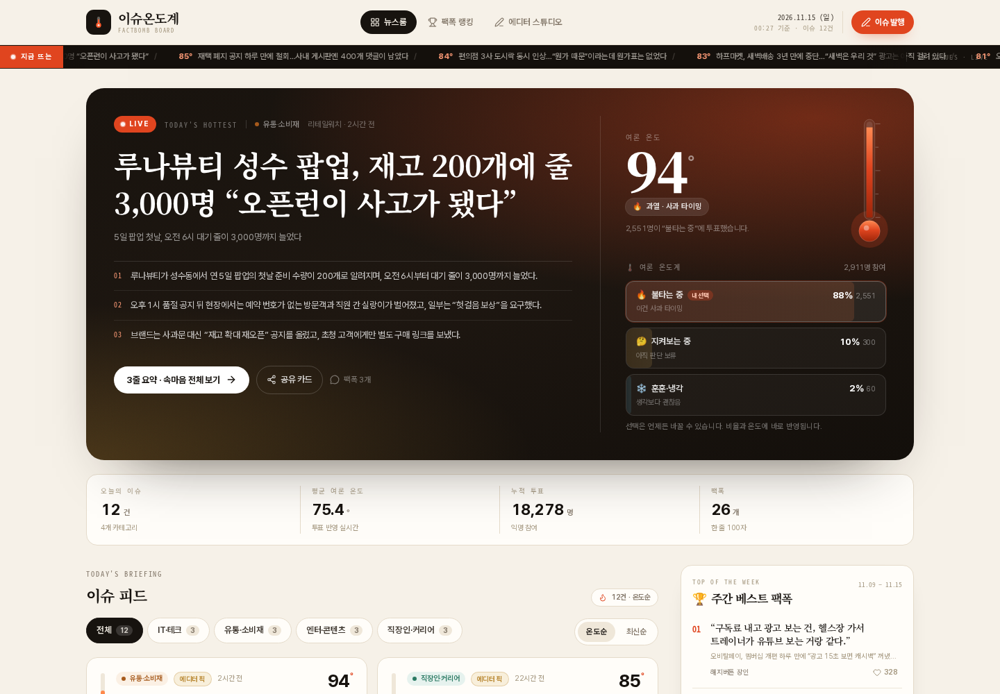
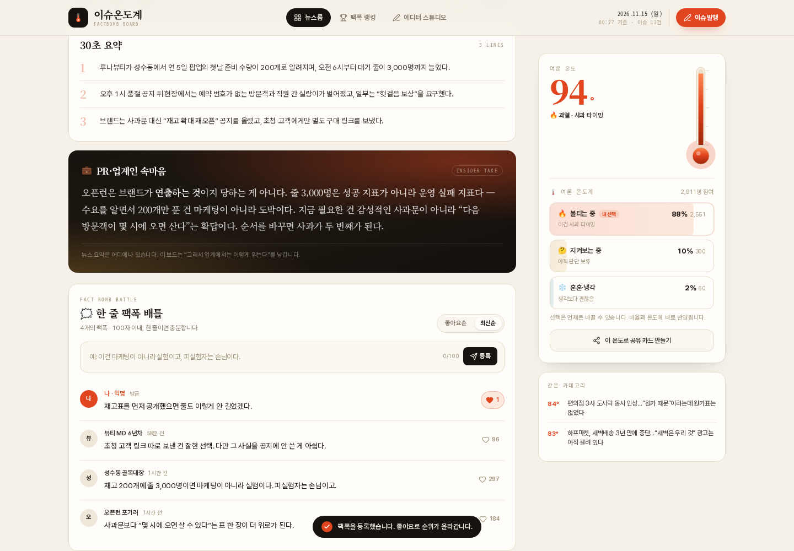
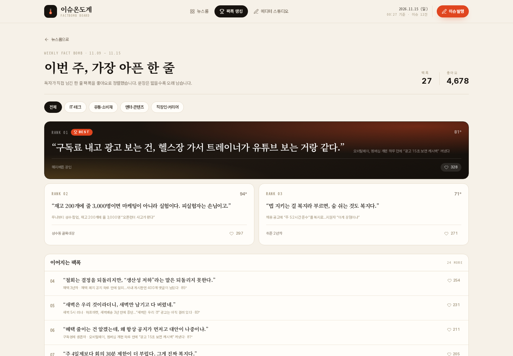
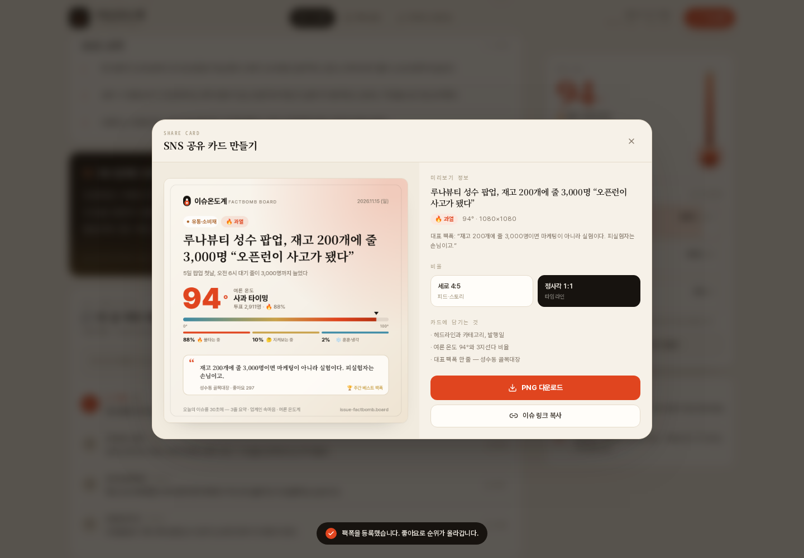
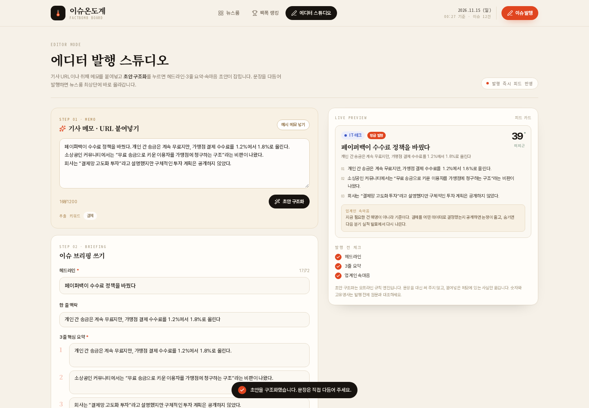
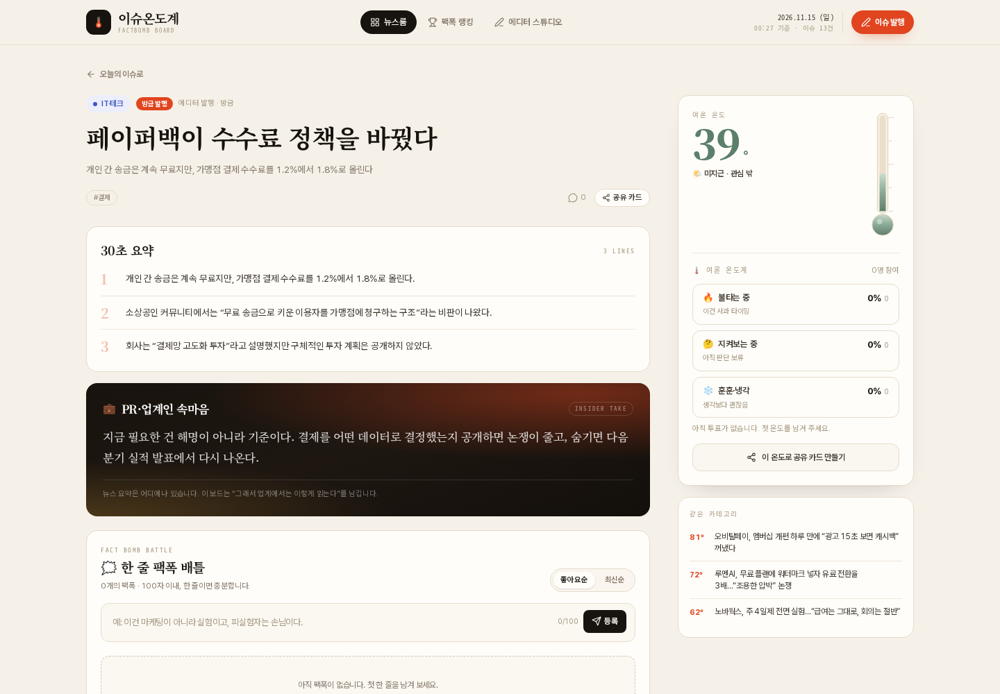
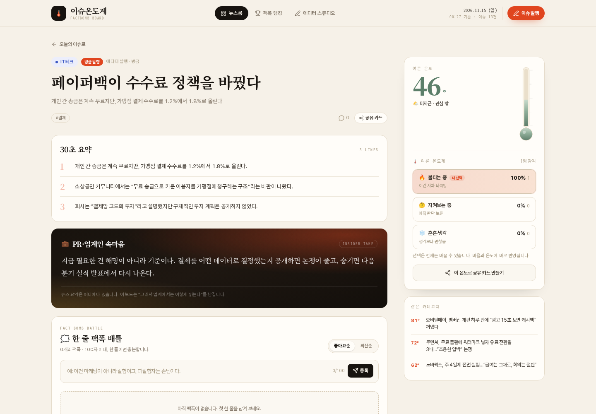
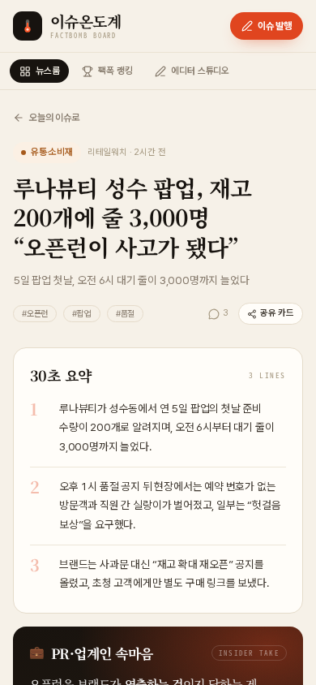
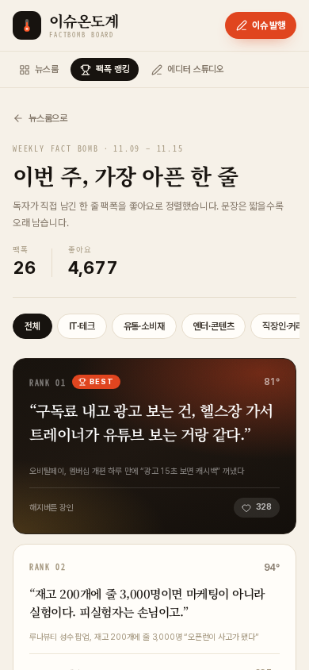

# 이슈온도계 — 한 줄 팩폭 이슈·트렌드 브리핑 보드

> **오늘의 이슈를 30초에 읽고, 한 줄로 참전하는 디지털 뉴스룸.**
> 3줄 핵심 요약 → 업계인 속마음 → 여론 온도계 투표 → 한 줄 팩폭 배틀 → SNS 공유 카드 → 에디터 발행까지, 한 화면에서.


뉴스를 요약만 해 주는 서비스는 넘친다. 실무자가 알고 싶은 건 “그래서 업계에서는 이걸 어떻게 읽는가”다.
이슈온도계는 기사 요약 위에 **PR·업계인 속마음**을 얹고, 독자가 **0~100° 여론 온도계**에 투표하고 **한 줄 팩폭**으로 참전하며, 그 결과를 **공유 카드**로 들고 나갈 수 있게 만든 편집국형 보드다.

> 이 보드에 등장하는 기업·브랜드·인물·매체는 **모두 가상**입니다. 실제 회사나 사건과 무관하며, 예시 콘텐츠로만 사용됩니다.

---

## 1. 한눈에 보는 기능

| 영역 | 내용 |
| --- | --- |
| **뉴스룸 피드** | 오늘의 최고 온도 이슈 히어로 + 4개 카테고리(IT·테크 / 유통·소비재 / 엔터·콘텐츠 / 직장인·커리어) 필터 + 온도순·최신순 정렬. 카드마다 온도 레일·3줄 요약·속마음 미리보기·투표 분포 |
| **이슈 브리핑** | 3줄 핵심 요약(30초), 💼 PR·업계인 속마음, 태그, 출처·시각, 같은 카테고리 이슈 |
| **여론 온도계** | 🔥 불타는 중 / 🤔 지켜보는 중 / ❄️ 훈훈·냉각 3지선다 투표. 실시간 비율 바, 참여 수, 내 선택 표시, 0~100° 온도계 애니메이션 |
| **팩폭 배틀** | 100자 한 줄 팩폭 등록, 좋아요(추천) 토글, 좋아요순·최신순 정렬, 이슈별 배틀 |
| **주간 베스트 TOP 5** | 전체 이슈의 팩폭을 좋아요로 정렬한 리더보드(레일) + 전용 랭킹 페이지(1~3위 포디움, 4위 이하 리스트, 카테고리 필터) |
| **공유 카드** | Canvas로 1080×1350(4:5) / 1080×1080(1:1) PNG 생성. 헤드라인·카테고리·온도·3지선다 비율·대표 팩폭·브랜드 마크 |
| **에디터 스튜디오** | 메모/URL 붙여넣기 → **1클릭 초안 구조화**(헤드라인·3줄 요약·속마음·카테고리·초기 온도) → 직접 다듬어 즉시 발행. 라이브 프리뷰·발행 전 체크 |
| **저장** | 투표·팩폭·발행 이슈를 localStorage에 보관(리로드 유지, 탭 간 동기화). `BoardRepository` 인터페이스로 백엔드 교체 가능 |

---

## 2. 화면

### ① 뉴스룸 — “오늘 가장 뜨거운 것”부터



- 히어로는 **오늘의 최고 온도 이슈**. LIVE 배지, 카테고리, 출처·시각, 세로 온도계, 3지선다 투표를 한 판에 담았습니다.
- 히어로 아래 통계 스트립은 발행 수·평균 온도·누적 투표·팩폭 수를 실시간 집계합니다.
- 카드의 왼쪽 얇은 세로 레일이 그 이슈의 온도입니다. 색은 온도 밴드(과열~냉각)를 따릅니다.
- 우측 레일에는 **주간 베스트 팩폭**, **오늘의 온도 지도**(카테고리 평균), **이 보드 읽는 법**, 에디터 진입 카드가 붙습니다.
- 상단 다크 티커는 지금 뜨는 이슈를 온도와 함께 흘려보냅니다(마우스를 올리면 정지).

### ② 이슈 상세 — 요약, 그리고 뉴스에 없는 한 문단


- **30초 요약**: 3문장. 무슨 일이 있었고, 어떻게 됐고, 그래서 무엇이 문제인지.
- **💼 PR·업계인 속마음**: 이 보드의 존재 이유. “사과문보다 확답이 먼저”, “오픈런은 브랜드가 연출하는 것” 같은 현장의 해석을 남깁니다.
- 사이드 패널은 스크롤을 따라오며 온도계·투표·공유·같은 카테고리 이슈를 붙잡아 둡니다.



- 팩폭은 **100자**. 등록 즉시 목록에 붙고, 좋아요로 순위가 바뀝니다. 내 글은 `나 · 익명`으로 구분됩니다.

### ③ 팩폭 랭킹 — 이번 주, 가장 아픈 한 줄



- 1위는 전폭 다크 카드, 2~3위는 나란히, 4위부터는 리스트. 좋아요 수가 곧 순위입니다.
- 카테고리 필터로 “이번 주 유통에서 가장 아픈 한 줄”만 볼 수 있습니다.
- 랭킹의 좋아요는 피드·상세와 같은 저장소를 쓰므로 어디서 누르든 순위가 함께 움직입니다.

### ④ 공유 카드 — 온도를 이미지로 들고 나가기

| 세로 4:5 (1080×1350) | 정사각 1:1 (1080×1080) |
| --- | --- |
|  |  |

- 헤드라인, 카테고리, 여론 온도와 밴드, 3지선다 비율, 대표 팩폭 한 줄, 브랜드 마크가 Canvas에 직접 그려집니다.
- 텍스트는 캔버스 폰트 측정으로 줄바꿈하고, 댓글 카드가 푸터를 침범하면 자동으로 축약·생략합니다.
- 실제 산출물: [`docs/share-card-sample.png`](docs/share-card-sample.png) (1080×1080)

### ⑤ 에디터 스튜디오 — 메모에서 발행까지 한 화면



- **초안 구조화**: 붙여넣은 메모에서 헤드라인 후보, 3줄 요약, 카테고리, 초기 온도, 태그를 뽑고 속마음 템플릿까지 채웁니다. 무엇을 채웠고 무엇이 비었는지 그대로 알려 줍니다.
- 라이브 프리뷰로 피드 카드 모양을 확인하고, 발행하면 **뉴스룸 최상단**에 올라갑니다.



- 발행 직후 상세 페이지로 이동하며 `방금 발행` 배지가 붙습니다. 투표가 0인 새 이슈는 첫 표에 온도가 실제로 움직입니다.



### ⑥ 모바일 · 태블릿

| 모바일 피드 | 모바일 상세 | 모바일 랭킹 |
| --- | --- | --- |
|  |  |  |

- 390px에서 가로 스크롤 없이 동작합니다(검증 항목). 히어로는 세로 온도계 대신 압축 온도 스트립으로 바꿔 3줄 요약이 먼저 보이게 했습니다.
- 태블릿(1024px)은 2단 피드가 유지됩니다: [12-tablet-feed.png](docs/screenshots/12-tablet-feed.png)

---

## 3. 여론 온도는 어떻게 계산하나

온도는 **편집자의 시작 온도 + 독자 투표의 열기**를 섞은 값입니다. 작은 표 수에서 바늘이 요동치지 않도록 편집 온도에 8표 분량의 사전 가중치를 둡니다.

```
heat  = (100 × hot + 55 × watch + 12 × cool) / (hot + watch + cool)
temp  = round( (baseTemp × 8 + 100 × hot + 55 × watch + 12 × cool) / (8 + hot + watch + cool) )
        → 3 ~ 99°로 클램프
```

- 🔥 불타는 중은 100°, 🤔 지켜보는 중은 55°, ❄️ 훈훈·냉각은 12°의 열기로 환산합니다.
- 이미 수천 표가 쌓인 이슈는 한 표로 1°가 바뀌지 않습니다. 대신 **비율 바와 참여 수**가 즉시 반응하고, 투표가 0인 새 이슈는 첫 표에 온도가 눈에 띄게 움직입니다.
- 밴드는 85° 이상 과열, 70° 이상 가열, 50° 이상 지켜보는 중, 30° 이상 미지근, 그 아래 냉각.

| 이슈 | 카테고리 | 온도 |
| --- | --- | --- |
| 루나뷰티 성수 팝업 오픈런 품절 사태 | 유통·소비재 | 94° 🔥 |
| 재택 폐지 공지 26시간 만에 철회 | 직장인·커리어 | 85° 🔥 |
| 편의점 3사 도시락 동시 인상 | 유통·소비재 | 84° |
| 하프마켓 새벽배송 중단 | 유통·소비재 | 83° |
| 오비탈페이 멤버십 개편 | IT·테크 | 81° |
| 아이돌 컴백 티저 AI 논란 | 엔터·콘텐츠 | 77° |
| 루멘AI 무료 플랜 워터마크 | IT·테크 | 72° |
| 채용 공고 “52시간 준수” 복지 논란 | 직장인·커리어 | 71° |
| 드라마 결말 유출 대응 | 엔터·콘텐츠 | 68° |
| 조용한 승진 제도 | 직장인·커리어 | 65° |
| 페이지온 정주행 상한 | 엔터·콘텐츠 | 64° |
| 노바웍스 주 4일제 실험 | IT·테크 | 62° |

---

## 4. 구조와 저장소 추상화

```
src/
├─ App.tsx                  # 해시 라우터(#/, #/issue/:id, #/ranking, #/editor) + 공유 모달/토스트
├─ hooks/useBoard.ts        # 보드 상태와 액션(투표·팩폭·좋아요·발행·초기화)
├─ lib/
│  ├─ content.ts            # 카테고리·반응 정의, 가상 브랜드 시드 이슈 12건 + 팩폭 26건
│  ├─ repo.ts               # BoardRepository 인터페이스 + LocalBoardRepository(시드/검증/마이그레이션)
│  ├─ temp.ts               # 온도 계산·밴드·비율(최대잔여법)
│  ├─ draft.ts              # 오프라인 초안 구조화 엔진(카테고리 스코어·온도 트리거·조사 처리)
│  ├─ share-card.ts         # Canvas 공유 카드 렌더러(텍스트 측정 줄바꿈·자동 축약)
│  ├─ selectors.ts          # 팩폭 랭킹 셀렉터
│  └─ format.ts             # 수치·상대시간·주간 범위·강조 파서
└─ components/              # 히어로·피드·카드·투표·상세·배틀·랭킹·공유 모달·에디터·헤더/푸터/토스트
```

모든 UI는 `BoardRepository`만 바라봅니다. 지금은 localStorage 구현 하나뿐이고, 공유 백엔드가 생기면 아래 세 메서드만 구현해 갈아 끼우면 됩니다.

```ts
export interface BoardRepository {
  load(): BoardSnapshot;
  save(snapshot: BoardSnapshot): void;
  reset(): BoardSnapshot;
}
```

저장 키는 `factbomb.board.v1` 하나이며, 담기는 값은 아래와 같습니다.

- `issues` — 발행된 이슈(시드 포함). 새로 발행한 이슈는 앞에 붙습니다.
- `votes` — 이슈별 `{ hot, watch, cool }` 누적 표.
- `myVotes` — 이슈별 내 선택(한 이슈에 하나, 변경 가능).
- `comments` — 팩폭(글·작성자·좋아요·시각).
- `likedComments` — 내가 좋아요한 팩폭 id(토글).

불러올 때 형태를 검증하고, 깨졌거나 버전이 다르면 시드로 되돌립니다. 푸터의 **데모 데이터 초기화**는 확인을 받은 뒤 시드 상태로 되돌립니다.

---

## 5. 초안 구조화는 무엇을 하나

`src/lib/draft.ts`는 API 없이 도는 결정적 규칙 엔진입니다.

1. URL을 분리해 출처로만 남기고, 본문 메모를 문장 단위로 나눕니다. URL만 있으면 “브라우저에서는 본문을 읽을 수 없다”고 알립니다(CORS 한계를 숨기지 않습니다).
2. 첫 줄이 짧고 마침표로 끝나지 않으면 헤드라인으로, 아니면 첫 문장을 62자 이내로 다듬어 헤드라인 후보로 씁니다.
3. 다음 문장들을 3줄 요약으로 채우고, 모자라면 쉼표 단위로 보충합니다. 그래도 모자라면 **빈 줄을 그대로 두고** “N줄만 채웠다”고 알립니다.
4. 카테고리별 키워드 사전으로 카테고리를 추정하고, 추출 키워드를 칩으로 보여 줍니다.
5. 강한 트리거(품절·논란·철회·유출·담합…) +9, 중간(인상·개편·제한…) +6, 약한(발표·출시…) +3으로 초기 온도를 28~92° 사이에서 추정합니다.
6. 업계인 속마음은 카테고리별 3개 템플릿 중 하나에 추출 키워드를 넣어 초안만 만듭니다. 한국어 조사(을/를·은/는·이/가)는 받침을 보고 붙입니다.
7. 숫자·고유명사는 절대 새로 만들지 않습니다. 발행 전 원문 대조를 안내합니다.

---

## 6. 실행

```bash
# Node 22+
npm install
npm run dev        # http://localhost:5185
npm run build      # tsc --noEmit && vite build
npm run preview    # http://localhost:4185 (프로덕션 빌드 확인)
npm run typecheck
```

기술 스택: **Vite 7 · React 19 · TypeScript 5.9 · Tailwind CSS 4**, 아이콘은 `lucide-react`. 폰트는 Pretendard(jsDelivr)와 Noto Serif KR(Google Fonts)을 불러오고, 없으면 시스템 폰트로 대체합니다.

---

## 7. 검증 결과

| 항목 | 결과 |
| --- | --- |
| `npx tsc --noEmit` | **0 errors** |
| `npm run build` | **성공** (JS 345 kB / gzip 107 kB, CSS 60 kB / gzip 11 kB) |
| Playwright Chromium 데스크톱 1440×1000 | 콘솔 에러·경고 **0**, 페이지 에러 **0** |
| Playwright Chromium 모바일 390×844 | 콘솔 에러·경고 **0**, 가로 오버플로 **없음** |
| 자동 검증 체크 | **40/40 통과** (`scripts/verify.py`) |

검증한 동작(발췌):

- 히어로·12개 시드 이슈 렌더, 온도 94° 표시
- 히어로 투표 → `aria-pressed`, `내 선택` 배지, localStorage 저장
- 카테고리 필터(IT 3건) · 전체 복귀 · 온도순/최신순 정렬 변화
- 카드 → 상세 이동, 30초 요약·속마음 렌더
- 팩폭 등록(100자 카운터 28/100), 저장, 좋아요 토글
- 공유 카드 PNG 데이터 생성·정사각 전환·다운로드(파일 20KB 이상)
- 팩폭 랭킹 27건·1위 328 좋아요
- 초안 구조화(헤드라인·3줄·카테고리·온도), 발행 → 상세 이동, `방금 발행`
- 새 이슈 첫 투표에 온도 상승, 리로드 후 유지, 피드 13건 최신순 1위
- 데모 초기화 후 12건 복귀, 모바일 구조화 동작

스크린샷은 `scripts/verify.py`가 같은 실행에서 `docs/screenshots/`에 다시 만듭니다.

---

## 8. 알려진 한계와 다음 단계

- **URL 본문 수집 없음** — 정적 사이트라 CORS로 외부 기사를 읽을 수 없습니다. 서버리스 함수나 백엔드를 붙이면 메모 없이도 구조화할 수 있습니다.
- **로컬 저장** — 지금은 브라우저 한 곳에만 저장됩니다. `BoardRepository`를 HTTP 구현으로 바꾸면 계정·동시 편집·모더레이션이 열립니다.
- **팩폭 모더레이션 없음** — 신고·숨김·작성자 인증은 백엔드가 필요합니다.
- **온도는 편집 가중치가 들어간 값** — 순수 투표 비율이 아닙니다. 계산식을 위에 공개해 두었으니 정책에 맞게 `PRIOR`와 가중치를 조정하면 됩니다.
- **다크 모드·다국어 없음** — 한국어 editorial 톤에 맞춘 단일 테마입니다.

---

© 2026 이슈온도계 · 모든 기업·브랜드·인물은 가상입니다.
