# 이슈온도계 — 오늘의 뉴스를 인스타 카드뉴스 5장으로

> **오늘 아침 언론사 RSS 13곳에서 실제 기사를 긁어와, 인스타 4:5 카드뉴스 5장 + A/B 투표·토론으로 바꿔 놓는 공개 이슈 보드.**
> 지어낸 예시 뉴스는 없습니다. 카드마다 **원문 기사 링크·출처·발행시각**이 붙고, PNG로 저장해 **바로 인스타에 올릴 수 있습니다.**


---

## 1. 무엇을 바꿨나 (v3 → v4)

사용자 지적: *"불필요하게 만들어줬어. 카드뉴스로 인스타에 올려서 주목을 받아야 하는데, 내용도 제대로 정리 안 돼 있지 않아? 뉴스도 제대로 안 들어가 있고."*

| v3 (지적받은 것) | v4 |
| --- | --- |
| 뉴스가 부실 — RSS 7곳 중 5곳이 연합뉴스, 요약이 짧으면 카드도 빈약 | **RSS 13곳**(연합뉴스 5개 섹션·경향·동아·동아경제·오마이뉴스·SBS·SBS경제·블로터·전자신문) + 후보 16건·본문 최대 12건 확인 |
| 팩트 2줄 + 양쪽 입장뿐 | **카드 5장** — ① 표지 훅 ② 팩트 3줄 ③ 왜 지금 뜨나·핵심 쟁점 ④ A vs B 대립 ⑤ 한 줄 팩폭·투표 질문 |
| 화면 비율이 제각각, 인스타에 못 올림 | **4:5 (1080×1350) 고정** + **현재 장 PNG 저장** + **5장 ZIP 한 번에** + **인스타 캡션·해시태그 원클릭 복사** |
| 한 줄 반응만 카드 안에 | 카드 아래 **A/B 진영을 고른 토론 댓글 + 공감 + 진영 필터** (서버 저장, 끊기면 이 기기에 저장) |
| HTML 태그·기자 머리말·사진 캡션·깨진 문자 섞임 | **전용 정제기** — 태그·저작권·`(서울=연합뉴스) 홍길동 기자 =`·`[사진]`·제로폭 문자 제거, 문장 단위로 자르고 단어 중간에서 끊지 않음 |
| 같은 사안을 여러 매체가 받아쓴 기사가 카드로 중복 | 제목 접두 18자 중복 제거 + **비슷한 문장(같은 팩트) 판별**로 팩트 3줄이 겹치지 않게 |

---

## 2. 화면

### ① 오늘의 카드뉴스 피드 (모바일)

- 1위 이슈는 큰 히어로 카드, 나머지는 번호·카테고리·온도·투표/댓글 현황이 붙은 리스트.
- 상단 띠에 **수집 시각 · 이슈 건수 · AI 상태 · 연결된 언론사 수**를 그대로 적습니다(숨기지 않음).

### ② 카드뉴스 5장 (4:5)

| 표지 | 무슨 일인데 (팩트 3줄) | 왜 지금 뜨나 · 쟁점 |
| --- | --- | --- |
|  |  | 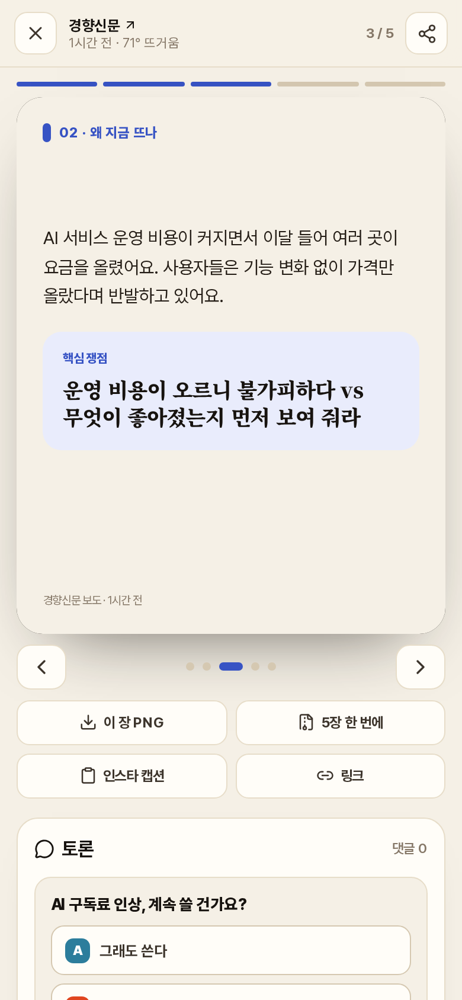 |

| A vs B | 한 줄 팩폭 · 질문 |
| --- | --- |
| 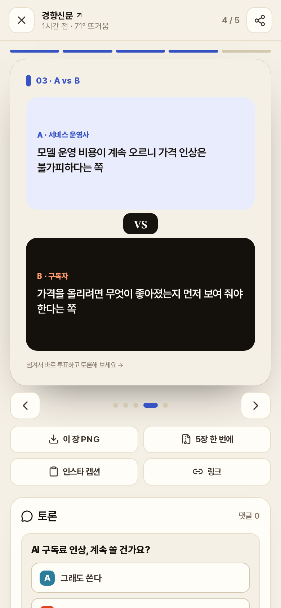 | 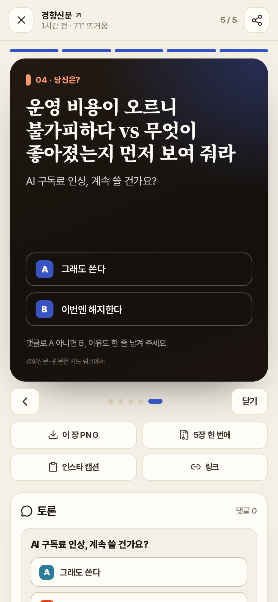 |

- **손끝·마우스로 끌면 카드가 그대로 따라 밀립니다.** 버튼을 눌렀을 때만 툭 넘어가던 방식을 없애고, 끄는 동안 `translateX`가 실시간으로 따라오다가 손을 떼면 이동 거리·속도(짧게 튕기기)에 따라 다음·이전 장으로 부드럽게 스냅합니다.
- 화살표·키보드(←/→)·진행 막대·아래 점으로도 같은 애니메이션으로 이동합니다.
- 카드 안을 세로로 스크롤할 때는 스와이프로 오인하지 않고, 첫 6px에서 가로/세로를 판별합니다(안드로이드 크롬 `touch-action: pan-y`).

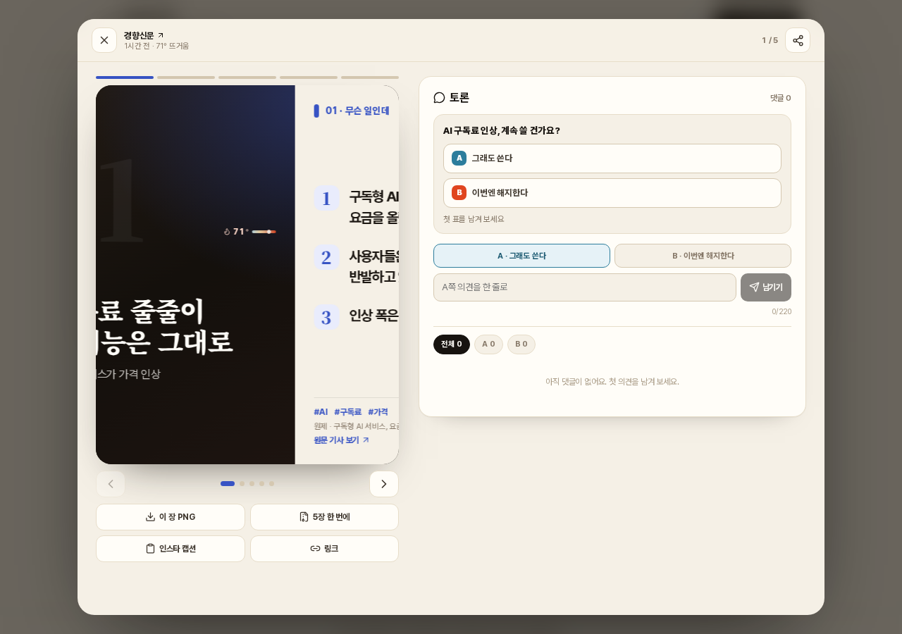

### ③ 인스타에 바로 올리기 — PNG · ZIP · 캡션

- **이 장 PNG**: 지금 보고 있는 장을 1080×1350 PNG로 저장합니다(캔버스에 직접 그려 화면 캡처보다 선명).
- **5장 한 번에**: 5장을 ZIP 파일 하나로 저장합니다(폰에서 여러 번 저장이 막히는 문제 회피).
- **인스타 캡션**: 훅 → 팩트 3줄 → 쟁점 → 투표 질문 → 카드 링크 → 해시태그까지 한 번에 복사.

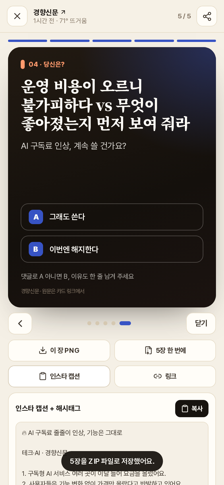

저장된 원본 PNG(1080×1350):

| 표지 | 팩트 | A vs B |
| --- | --- | --- |
| 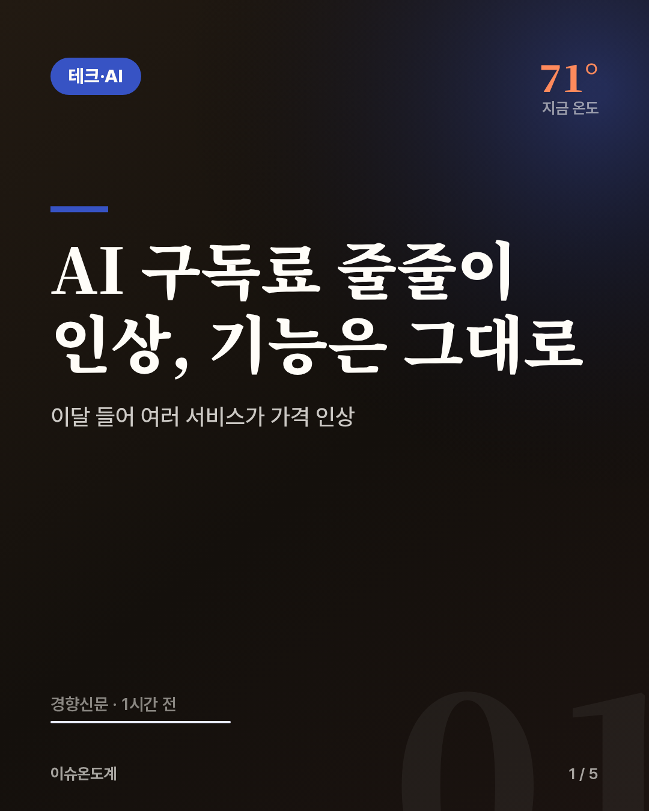 | 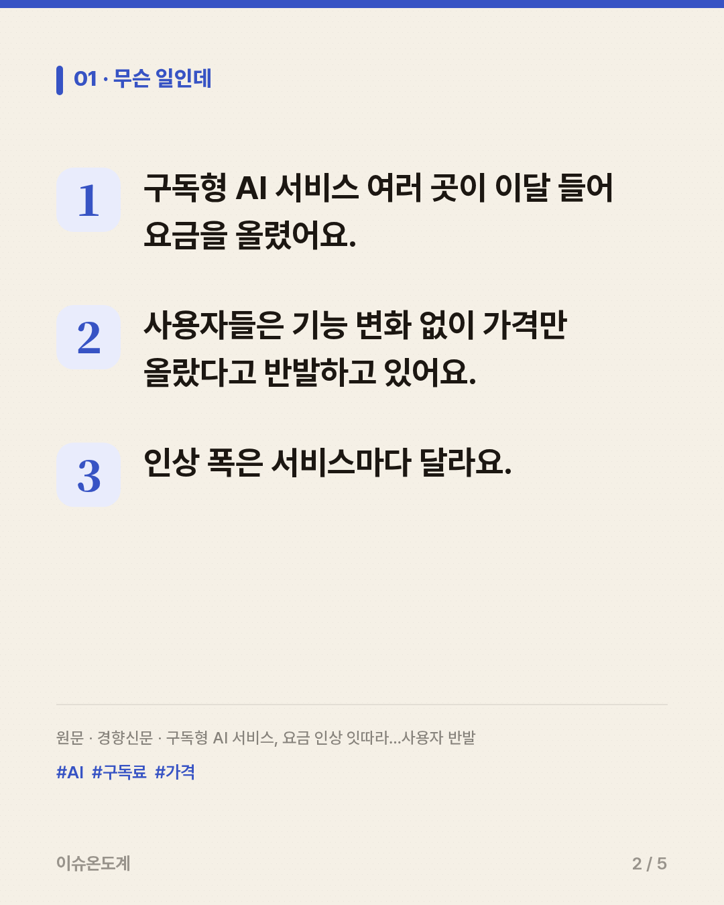 |  |

### ④ 카드 아래 투표 + 토론

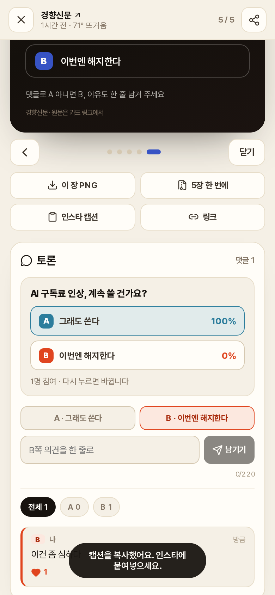

- A/B를 누르면 **퍼센트 바와 누적 참여 수**가 갱신되고, 다시 누르면 바뀝니다.
- 댓글은 **A쪽/B쪽 진영을 고른 뒤** 남깁니다. 목록에서 진영·익명 꼬리표·시간·**공감**이 보이고, 전체/A/B로 필터할 수 있습니다.
- 공용 저장소가 없거나 연결이 끊기면 **이 브라우저(localStorage)에 내 표·댓글·공감이 남고** 화면에 그 사실을 적습니다.
- **공유하기**(모바일 공유 시트) / **링크 복사** → `.../#/i/<카드id>` 로 받은 사람은 그 카드와 토론이 바로 열립니다.

### ⑤ 뉴스로 만들기 — 기사 링크 또는 한 줄

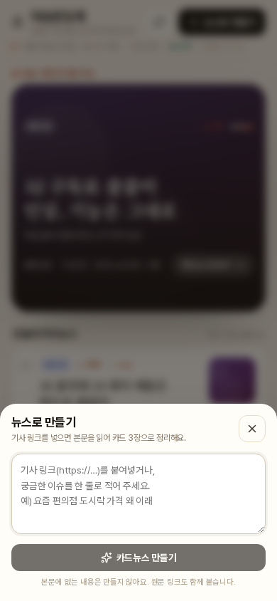

- 언론사 기사 **URL을 넣으면 서버가 본문을 직접 읽어**(SSRF 차단) 같은 5장 형식의 카드를 만듭니다.
- 링크 없이 "요즘 편의점 도시락 가격 왜 이래" 같은 **한 줄**로도 카드가 만들어집니다.

### ⑥ AI가 없을 때도 정직하게


- AI 키가 없으면 **실제 헤드라인·요약 그대로** 카드를 만들고 `AI 없이 제목` 배지와 `온도 미측정`을 표시합니다.
- 팩트 3줄은 기사 요약 문장에서 채우되, 없는 수치를 만들지 않습니다. 양쪽 입장 정리가 없으면 숨기지 않고 그렇다고 적습니다.

### ⑦ 데스크톱

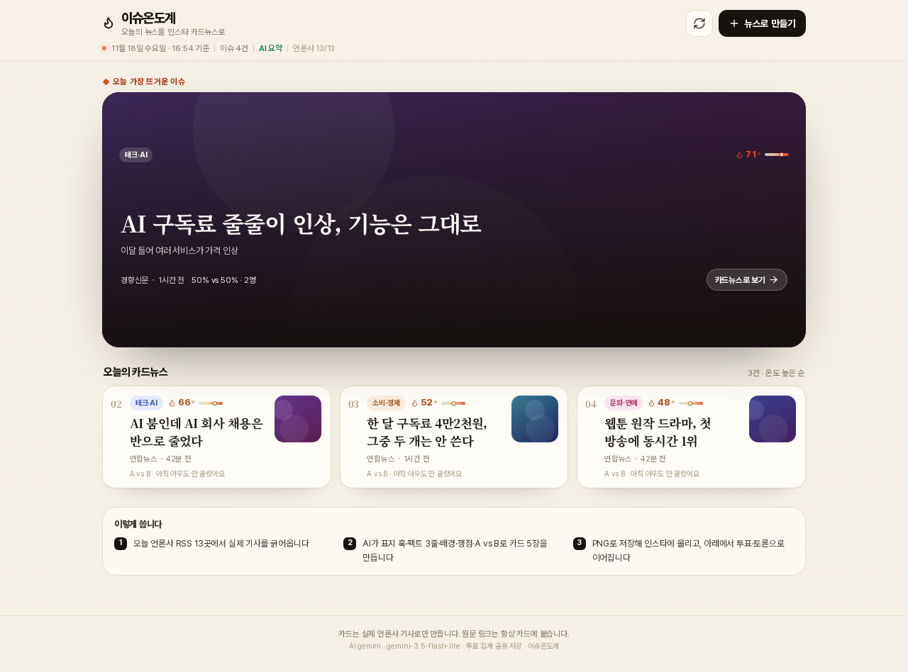
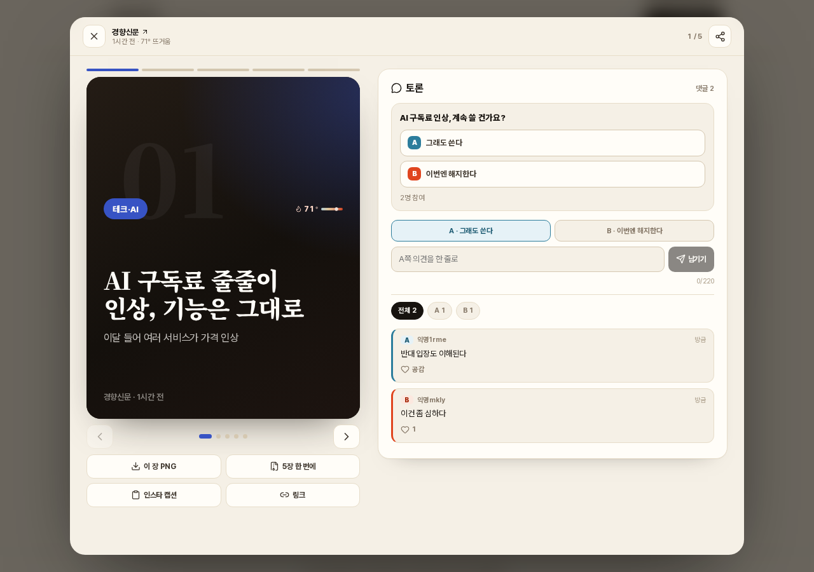

---

## 3. 동작 방식

```
[언론사 RSS 13곳]  ← 서버가 병렬로 fetch (8초 타임아웃, 실패한 피드는 건너뜀)
      ↓ 제목·요약·발행시각·원문 링크·대표 이미지 파싱 + 기자 머리말·사진 캡션·저작권 문구 제거
[오늘 기사 후보]   ← 26시간 이내 + 제목/접두 중복 제거 + MZ·직장·물가·AI·문화 키워드 점수
      ↓ 카테고리가 몰리지 않게 라운드로빈으로 16건
[본문 확인]        ← 요약이 짧은 상위 12건을 동시 6건씩 읽어 사실 근거로 사용(전체 12초 예산)
      ↓
[AI 카드 생성]     ← Gemini(무료 키) 또는 OpenAI — 5~6건을 골라 5장 구성으로 정리
      ↓ 12분 캐시(Upstash/Supabase/메모리)
[피드 + 투표·토론]  ← A/B 집계와 댓글은 /api/poll 로 공용 저장
```

- **수집원**: 연합뉴스(종합·경제·산업·문화·정치), 경향신문, 동아일보(종합·경제), 오마이뉴스, SBS(종합·경제), 블로터, 전자신문.
  모두 제목·요약·원문 링크·발행시각을 함께 주는 RSS입니다. Google 뉴스 RSS는 요약이 링크뿐이라 **사실 근거로 쓸 수 없어 넣지 않았습니다**.
  일부 언론사(매일경제 등)는 서버 요청을 403으로 막아 수집 대상에서 뺐고, 막힌 피드는 응답의 `feeds`에 `ok:false`로 정직하게 표시됩니다.
- **AI 프롬프트 원칙**: 주어진 기사에 없는 수치·기관·인물·회사·날짜를 만들지 말 것 / 확인되지 않은 추측 금지 / 카드당 1~2문장 / 팩트는 서로 다른 내용 3개 / 투표는 정답 없는 양자택일.
- **AI가 실패하면**: 실제 헤드라인 카드로 자동 폴백(`ai:false`). 앱은 그 사실을 표시합니다.

---

## 4. API

### `GET /api/trending`
```jsonc
{
  "ok": true, "mode": "shared", "store": "redis",
  "ai": { "provider": "gemini", "model": "gemini-3.5-flash-lite" },
  "generatedAt": 1794834907764, "stale": false,
  "feeds": [{ "name": "연합뉴스 종합", "ok": true }, ...],
  "issues": [{
    "id": "1b5td2e1u0h",
    "category": "work",                       // work | mz | money | tech | culture
    "title": "직장인 10명 중 6명 \"점심값 1만5천원 넘으면 부담\"",
    "source": "연합뉴스", "url": "https://www.yna.co.kr/view/...",
    "publishedAt": 1794829867000, "image": "https://img.yna.co.kr/...",
    "hook": "점심값 1만5천원, 이제 월급에서 빠지는 고정비",
    "kicker": "직장인 58%가 \"1만5천원 넘으면 부담\"",
    "facts": ["...", "...", "..."],           // 정확히 3줄 (부족하면 기사 문장으로 채움)
    "background": "왜 지금 떴는지 2문장",
    "point": "무엇을 두고 갈리는지 한 줄",
    "sides": { "labelA": "식당 쪽", "labelB": "직장인 쪽", "a": "...", "b": "..." },
    "poll": { "question": "...", "a": "...", "b": "..." },
    "temp": 74, "tags": ["점심값", "물가", "직장인"], "ai": true
  }]
}
```
- `?refresh=1` 새로 긁기, `?issue=<id>` 카드 하나 다시 꺼내기.
  카드는 하나씩 따로 **7일 보관**하므로, 받은 사람이 며칠 뒤에 링크를 열어도 그 카드가 뜹니다(캐시가 새로 바뀌어도 유지).
- 피드를 하나도 못 읽으면 `503 feeds_unreachable`, 없는 카드는 `404`.

### `POST /api/briefing`
```jsonc
{ "url": "https://www.yna.co.kr/view/...", "text": null }   // 또는 { "text": "궁금한 이슈 한 줄" }
→ { "ok": true, "engine": "ai", "ai": { "provider": "gemini", "model": "..." }, "issue": { ... } }
```
- `engine: "headline"` 이면 AI 없이 제목·첫 문장만으로 만든 카드(이유가 `notice`에 담깁니다).
- 오류: `400 too_short` / `400 google_news_link` / `400 article_unreadable`(사설망·메타데이터·비HTML 포함) / `413 too_long` / `429 rate_limited`.

### `GET·POST /api/poll`
```jsonc
GET  /api/poll?ids=<id1>,<id2>&voterId=<익명id>
→ { "ok": true, "mode": "shared", "polls": { "<id>": {
      "question": "...", "a": "...", "b": "...",
      "counts": { "a": 3, "b": 1 }, "total": 4, "my": "a", "commentCount": 2,
      "comments": [{ "id": "c...", "side": "b", "text": "이건 좀 심하다",
                     "at": 1794834900000, "tag": "1ytt", "likes": 1,
                     "liked": true, "mine": false }] } } }

POST /api/poll { "action": "vote",    "issueId": "<id>", "choice": "a", "voterId": "<익명id>",
                 "question": "...", "a": "...", "b": "..." }
POST /api/poll { "action": "comment", "issueId": "<id>", "side": "b", "text": "의견",
                 "commentId": "c...", "voterId": "<익명id>" }
POST /api/poll { "action": "like",    "issueId": "<id>", "commentId": "c...", "voterId": "<익명id>" }
```
- `voterId`는 브라우저가 만든 익명 값입니다. **응답에는 다시 내보내지 않고** `my`(내 선택)·`mine`(내 댓글)만 돌려줍니다.
- 계정·IP·이름은 어디에도 저장하지 않습니다.
- 한 카드에 댓글 200개·1인 5개까지. 같은 `commentId`로 다시 보내면 중복 저장되지 않습니다(브라우저 로컬 저장과 이어짐).

---

## 5. 배포 (Vercel)

1. 저장소를 Vercel에 연결하면 `vercel.json`이 Vite `dist/` + `api/*.ts`를 잡습니다(함수 maxDuration 60초).
2. 환경변수 (모두 선택이지만 **AI 카드 정리에는 AI 키가 필요**합니다)

| 이름 | 하는 일 | 없으면 |
| --- | --- | --- |
| `GEMINI_API_KEY` | 무료 Google AI Studio 키(`AIza…`/`AQ.…`). 기본 모델 `gemini-3.5-flash-lite` | 헤드라인 카드로 폴백 |
| `GEMINI_MODEL` | 모델명 바꾸기(기본값 그대로 두면 됨) | `gemini-3.5-flash-lite` → 3.8-flash → 3.6-flash → 2.5-flash 순으로 자동 시도 |
| `OPENAI_API_KEY` | Gemini 대신 OpenAI(`gpt-4o-mini`) 사용 | Gemini 우선 |
| `UPSTASH_REDIS_REST_URL` + `UPSTASH_REDIS_REST_TOKEN` | 투표·댓글 집계와 카드 캐시를 공용 저장 | 함수 메모리(인스턴스마다 따로) + 브라우저 로컬 저장 |
| `SUPABASE_URL` + `SUPABASE_SERVICE_ROLE_KEY` | 위 대신 Supabase | 위와 같음 |

3. Supabase를 쓸 경우 SQL Editor에서 1회:
```sql
create table if not exists issue_thermo_kv (
  key text primary key,
  data jsonb not null default '{}'::jsonb,
  updated_at timestamptz not null default now()
);
alter table issue_thermo_kv enable row level security;  -- 정책은 열지 않음(service_role로만 접근)
```
4. 공용 DB가 없으면 상단 배지가 `투표는 이 기기 기준`으로 표시되고, 토론 입력 아래에도 그 사실이 나옵니다(공용인 척하지 않습니다).

---

## 6. 로컬에서 돌리기

```bash
npm install
npm run dev                 # 화면만(서버 없음) → 정적 모드
npm run build && npm run serve -- --port=4185 --ai=gemini --store=redis   # 가짜 RSS·가짜 AI로 전체 흐름
npm run verify              # Playwright E2E (아래 표)
npm run verify:drag         # 드래그·스와이프 전용 E2E
```

`scripts/serve.mjs` 옵션
| 옵션 | 설명 |
| --- | --- |
| `--api=on\|off` | off 면 GitHub Pages처럼 `/api` 404 |
| `--feeds=on\|real\|off` | on: 가짜 언론사 RSS 13곳, **real: 실제 연합뉴스·경향·동아·SBS·블로터·전자신문 RSS**, off: 연결 실패 상황 |
| `--ai=gemini\|demo\|off` | 가짜 Gemini(응답 규격 동일) / demo는 문서용 카드 문구 / off는 키 없음 |
| `--store=redis\|memory` | 가짜 Upstash로 공용 집계 경로 검증 |
| `--allow-local=off` | 기사 읽기의 사설망 차단을 배포 설정과 동일하게 켬 |

---

## 7. 검증 결과 (v4, 2026-11-18)

`npm run verify` → **119/119 통과, 콘솔 에러·경고 0**

| 시나리오 | 확인한 것 |
| --- | --- |
| A. 모바일 390 | 피드 4건+, 히어로 훅·출처·시간, **카드 5장 넘김(1/5→5/5)**, 팩트 3줄(서로 다른 내용), 배경·핵심 쟁점, A vs B 라벨, 표지/질문 슬라이드, **현재 장 PNG(1080×1350) 저장**, **5장 ZIP(속 PNG 모두 1080×1350)**, 캡션(훅·해시태그·링크) 복사, 카드 아래 투표 → % 반영, **B 진영 댓글 등록·공감·필터**, 새로고침 후 내 표·댓글 유지, 공유 링크로 바로 열기, 가로 넘침 0 |
| B. 두 번째 브라우저 | 같은 공용 저장소에서 **앞서 던진 표와 댓글이 보이고**, 새 표로 50:50, 새 댓글 누적 |
| C. 뉴스로 만들기 | 기사 URL → 본문 읽고 5장 카드 생성, 한 줄 이슈로도 생성, 짧은 입력 차단, 구글 뉴스 링크 거부, **사설망·메타데이터·file:// 차단(SSRF)** |
| D. AI 키 없음 | 실제 헤드라인 카드, `AI 없이 제목`, `온도 미측정`, 요약에서 팩트 3줄, 입장 비교 없음을 숨기지 않고 설명, 투표는 동작 |
| E. 정적 배포 | 안내 화면, **`/api` 요청 0건** |
| F. 데스크톱 1280 | 3열 그리드, 카드(4:5) + **오른쪽 토론 2단**, 가로 넘침 0 |
| G. 드래그 스와이프 (`npm run verify:drag`) | 끄는 도중 중간 프레임 translateX가 손을 따라옴(점프 아님), 마우스·터치 스와이프, 짧은 튕기기, 살짝 끌면 제자리, 첫 장 저항, 투표 버튼 위에서 끌어도 넘어가고 클릭은 취소, 세로 스크롤은 넘기지 않음 — 26/26 |
| API 단위 | **13개 피드 전부 수집**, 카드마다 원문 URL·출처·시각, **훅·팩트3·배경·쟁점·양쪽 라벨·투표**, 카테고리·온도 범위, 본문에 HTML 태그 없음, 공유 카드 재조회 200, 없는 카드 404, 잘못된 선택 400, **댓글 진영 검증·저장·공감 토글**, `my`만 노출(voterId 비노출), 카드별 보관 |

### 실제 RSS 스모크 테스트 (2026-11-18, 이 환경·AI 키 없음)

```
feeds: 13/13 · cards: 5
- mz    | 동아일보 | 교사노조 "AI치팅 제보센터, 폐쇄하라"…
- tech  | 블로터   | [핀다 확장 청구서]② 중저신용 노하우 부재…
- money | 동아일보 | 4대 은행 '깡통대출' 5조 돌파…부실기업 증가세가 더 빨라
- work  | 연합뉴스 | 인천도시공사 노조 "시의회 행감 새벽 3시15분 종료…개선 필요"
- culture | 연합뉴스 | 배종옥 첫 공포영화 '완벽한 집' 25일 개봉…장규리와 호흡
```

---

## 8. 파일 구조

```
api/
  _shared.ts    공통: AI 호출(Gemini→OpenAI), 저장소(Redis→Supabase→메모리), 기사 읽기(SSRF 차단), 뉴스 텍스트 정제
  trending.ts   RSS 13곳 수집 → 후보 채점 → 본문 확인 → AI 5장 카드 → 12분 캐시
  briefing.ts   기사 링크/한 줄 → 카드 1건
  poll.ts       A/B 투표 · 진영별 토론 댓글 · 공감
src/
  App.tsx                 피드·뷰어·상태 관리
  components/CardNewsViewer.tsx  4:5 카드 5장 뷰어 + PNG/ZIP/캡션 + 토론 연결
  components/Discussion.tsx      투표 게이지 · 댓글 쓰기/목록/공감/필터
  lib/cardImage.ts        캔버스로 1080×1350 PNG 5장 그리기
  lib/zip.ts              PNG 5장을 ZIP 하나로(무압축, 외부 라이브러리 없음)
  lib/api.ts              서버 호출 + localStorage 폴백(내 표·댓글·공감)
  lib/share.ts            인스타 캡션·해시태그 생성, 공유/복사
  cardnews.css            카드뉴스·토론 스타일
scripts/
  serve.mjs     Vercel 없이 api/*.ts를 그대로 실행하는 로컬 서버(가짜 RSS·AI·Redis)
  verify.py     Playwright E2E 119개 체크
  verify-drag.py 드래그 전용 E2E 26개 체크
```
