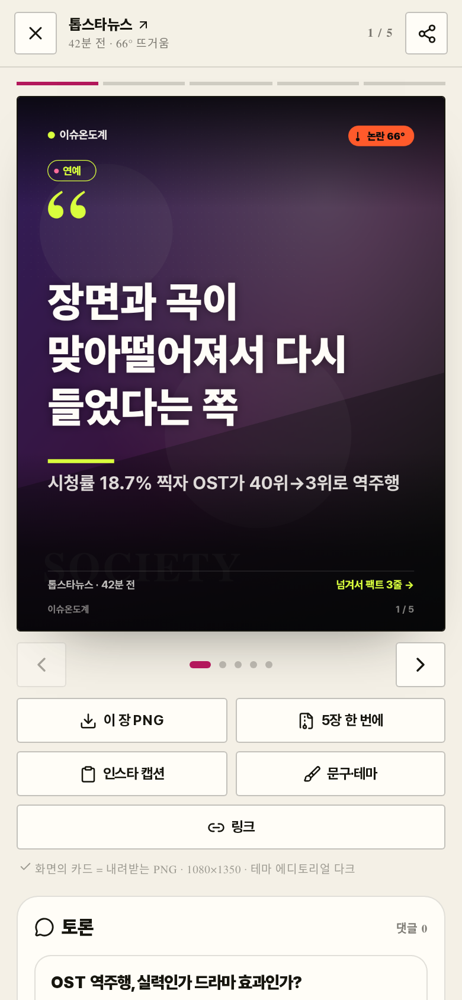
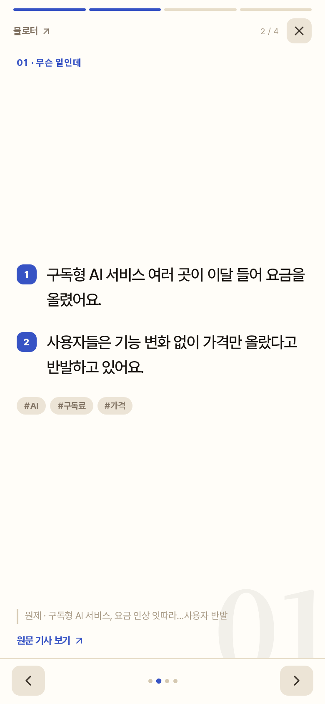
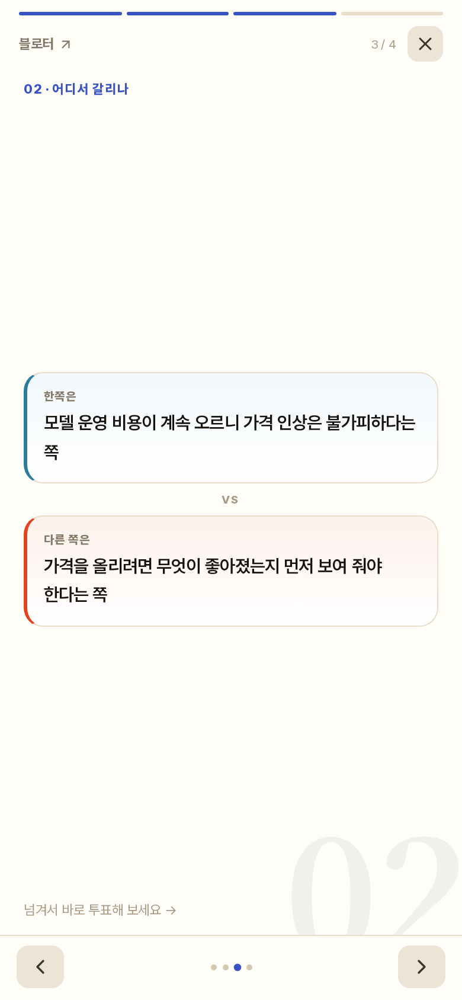
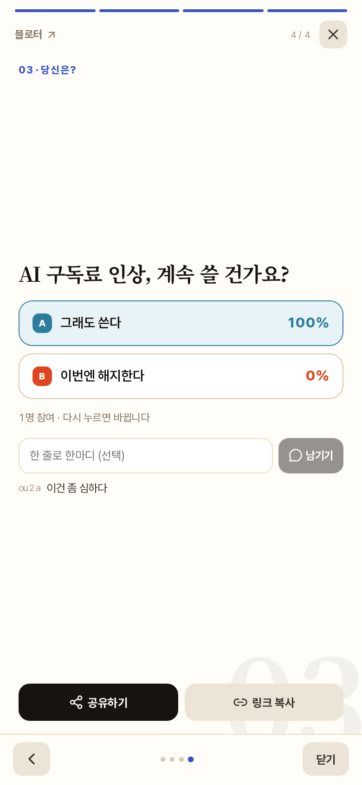
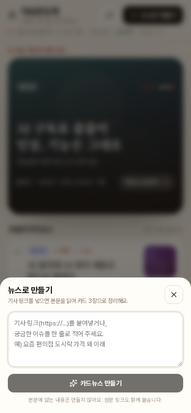
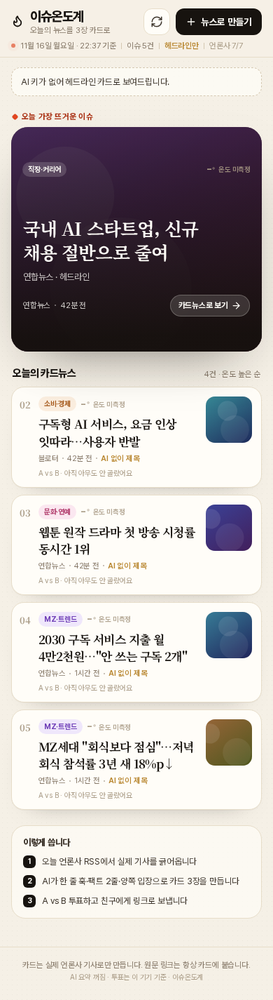

# 이슈온도계 — 오늘의 실제 뉴스를 3장 카드로

> **오늘 아침 언론사 RSS에서 실제 기사를 긁어와, 카드뉴스 3장 + A/B 투표로 바꿔 놓는 공개 이슈 보드.**
> 지어낸 예시 뉴스는 없습니다. 모든 카드에는 **원문 기사 링크·출처·발행시각**이 붙고, 30초면 읽고 한 표를 던질 수 있습니다.


---

## 1. 무엇을 바꿨나 (v2 → v3)

| v2 (지적받은 것) | v3 |
| --- | --- |
| 가짜 예시 뉴스 12건을 하드코딩 | **실시간 수집** — 연합뉴스·블로터·매일경제 RSS 7곳을 서버가 직접 읽어 오늘 기사만 사용 |
| 긴 줄글 3문단 + 속마음 + 팩폭 배틀 | **카드뉴스 4장** — ① 한 줄 훅 ② 팩트 2줄 ③ 양쪽 입장 ④ A/B 투표 (카드마다 1~2문장) |
| 0~100° 3지선다(불타는/지켜보는/냉각) | **A vs B 선택형 투표** — 한 번 누르면 즉시 % 바 + 누적 참여 수, 다시 누르면 변경 |
| 데스크톱 뉴스룸 레이아웃 | **모바일 퍼스트 매거진** — 폰에서 카드 넘기듯 읽고, 데스크톱에서는 폰 크기 프레임으로 |
| 무엇을 하는 서비스인지 불명확 | 첫 화면에서 "오늘 가장 뜨거운 이슈 → 오늘의 카드뉴스" 순서로 바로 읽힘 |

---

## 2. 화면

### ① 오늘의 카드뉴스 피드 (모바일)

- 1위 이슈는 큰 히어로 카드, 나머지는 번호·카테고리·온도·투표 현황이 붙은 리스트.
- 상단 띠에 **수집 시각 · 이슈 건수 · AI 상태 · 연결된 언론사 수**를 그대로 적습니다(숨기지 않음).

### ② 카드뉴스 4장

| 표지 | 무슨 일인데 | 어디서 갈리나 | 당신은? |
| --- | --- | --- | --- |
|  |  |  |  |

- **손끝·마우스로 끌면 카드가 그대로 따라 밀립니다.** 버튼을 눌렀을 때만 툭 넘어가던 방식을 없애고, 끄는 동안 `translateX`가 실시간으로 따라오다가 손을 떼면 이동 거리·속도(짧게 튕기기)에 따라 다음·이전 장으로 부드럽게 스냅합니다. 데스크톱에서는 마우스로 잡아 끌어도 됩니다.
- 화살표 버튼·키보드(←/→)·상단 진행 막대·아래 점을 눌러도 같은 애니메이션으로 이동합니다.


- 카드 안을 세로로 스크롤할 때는 스와이프로 오인하지 않고, 첫 6px에서 가로/세로를 판별합니다.
- ②에는 **원제(원문 제목)** 를 함께 남겨, 요약과 실제 기사를 대조할 수 있게 했습니다.

### ③ 투표 · 한 줄 반응 · 공유

- A/B 중 하나를 누르면 **퍼센트 바가 애니메이션으로 차오르고 누적 참여 수**가 갱신됩니다.
- 한 줄 반응(60자)은 익명 꼬리표와 함께 카드에 남습니다.
- **공유하기**(모바일 공유 시트) / **링크 복사** → `.../#/i/<카드id>` 로 받은 사람은 그 카드가 바로 열립니다.

### ④ 뉴스로 만들기 — 기사 링크 또는 한 줄



- 언론사 기사 **URL을 넣으면 서버가 본문을 직접 읽어**(SSRF 차단) 같은 형식의 카드를 만듭니다.
- 링크 없이 "요즘 편의점 도시락 가격 왜 이래" 같은 **한 줄**로도 카드가 만들어집니다.

### ⑤ AI가 없을 때도 정직하게



- AI 키가 없으면 **실제 헤드라인 그대로** 카드를 만들고 `AI 없이 제목` 배지와 `온도 미측정`을 표시합니다.
- 무엇이 꺼져 있는지 상단 띠와 안내 줄에 그대로 적습니다. 지어낸 문장을 채우지 않습니다.

### ⑥ 데스크톱


---

## 3. 동작 방식

```
[언론사 RSS 7곳]  ← 서버가 병렬로 fetch (9초 타임아웃, 실패한 피드는 건너뜀)
      ↓ 제목·요약·발행시각·원문 링크·대표 이미지 파싱
[오늘 기사 후보]  ← 30시간 이내 + 중복 제거 + MZ·직장·물가·AI·문화 키워드 점수
      ↓ 카테고리가 몰리지 않게 라운드로빈으로 10건
[본문 확인]       ← 상위 6건은 기사 본문까지 읽어 사실 근거로 사용(보일러플레이트 제거)
      ↓
[AI 카드 생성]    ← Gemini(무료 키) 또는 OpenAI — 4~5건을 골라 카드 4장으로 정리
      ↓ 12분 캐시(Upstash/Supabase/메모리)
[피드 + 투표]     ← A/B 집계는 /api/poll 로 공용 저장
```

- **수집원**: 연합뉴스(종합·경제·산업·문화·정치), 블로터, 매일경제 — 모두 제목·요약·원문 링크·발행시각을 함께 주는 RSS입니다.
  Google 뉴스 RSS는 요약이 링크뿐이라 **사실 근거로 쓸 수 없어 넣지 않았습니다**(가짜 요약을 만들지 않기 위한 결정).
- **AI 프롬프트 원칙**: 주어진 기사에 없는 수치·기관·인물·회사·날짜를 만들지 말 것 / 확인되지 않은 추측 금지 / 카드당 1~2문장.
- **AI가 실패하면**: 실제 헤드라인 카드로 자동 폴백(`ai:false`). 앱은 그 사실을 표시합니다.

---

## 4. API

### `GET /api/trending`
```jsonc
{
  "ok": true, "mode": "shared", "store": "redis",
  "ai": { "provider": "gemini", "model": "gemini-3.5-flash-lite" },
  "generatedAt": 1794834907764, "stale": false,
  "feeds": [{ "name": "연합뉴스 종합", "ok": true }, ...],
  "issues": [{
    "id": "1b5td2e1u0h",
    "category": "work",                       // work | mz | money | tech | culture
    "title": "직장인 10명 중 6명 \"점심값 1만5천원 넘으면 부담\"",
    "source": "연합뉴스", "url": "https://www.yna.co.kr/view/...",
    "publishedAt": 1794829867000, "image": "https://img.yna.co.kr/...",
    "hook": "점심값 1만5천원, 이제 월급에서 빠지는 고정비",
    "kicker": "직장인 58%가 \"1만5천원 넘으면 부담\"",
    "facts": ["직장인 1천명 중 58%가 ...", "1년 전 같은 조사보다 ..."],
    "sides": { "a": "물가가 오른 만큼 ...", "b": "월급은 그대로인데 ..." },
    "poll": { "question": "점심값 1만5천원, 받아들일 만한가요?", "a": "이 정도면 이해한다", "b": "아직은 너무 비싸다" },
    "temp": 74, "tags": ["점심값", "물가"], "ai": true
  }]
}
```
- `?refresh=1` 새로 긁기, `?issue=<id>` 카드 하나 다시 꺼내기.
  카드는 하나씩 따로 **7일 보관**하므로, 받은 사람이 며칠 뒤에 링크를 열어도 그 카드가 뜹니다(캐시가 새로 바뀌어도 유지).
- 피드를 하나도 못 읽으면 `503 feeds_unreachable`, 없는 카드는 `404`.

### `POST /api/briefing`
```jsonc
{ "url": "https://www.yna.co.kr/view/...", "text": null }   // 또는 { "text": "궁금한 이슈 한 줄" }
→ { "ok": true, "engine": "ai", "ai": { "provider": "gemini", "model": "..." }, "issue": { ... } }
```
- `engine: "headline"` 이면 AI 없이 제목·첫 문장만으로 만든 카드(이유가 `notice`에 담깁니다).
- 오류: `400 too_short` / `400 google_news_link` / `400 article_unreadable`(사설망·메타데이터·비HTML 포함) / `413 too_long` / `429 rate_limited`.

### `GET·POST /api/poll`
```jsonc
GET  /api/poll?ids=<id1>,<id2>&voterId=<익명id>
→ { "ok": true, "mode": "shared", "polls": { "<id>": {
      "question": "...", "a": "...", "b": "...",
      "counts": { "a": 3, "b": 1 }, "total": 4, "my": "a",
      "reactions": [{ "text": "이건 좀 심하다", "at": 1794834900000, "tag": "1ytt" }] } } }

POST /api/poll { "action": "vote", "issueId": "<id>", "choice": "a", "voterId": "<익명id>",
                 "question": "...", "a": "...", "b": "..." }
POST /api/poll { "action": "react", "issueId": "<id>", "text": "한 줄 반응", "voterId": "<익명id>" }
```
- `voterId`는 브라우저가 만든 익명 값입니다. **응답에는 다시 내보내지 않고** `my`(내 선택)만 돌려줍니다.
- 계정·IP·이름은 어디에도 저장하지 않습니다.

---

## 5. 배포 (Vercel)

1. 저장소를 Vercel에 연결하면 `vercel.json`이 Vite `dist/` + `api/*.ts`를 잡습니다(함수 maxDuration 60초).
2. 환경변수 (모두 선택이지만 **실시간 뉴스에는 AI 키가 필요**합니다)

| 이름 | 하는 일 | 없으면 |
| --- | --- | --- |
| `GEMINI_API_KEY` | 무료 Google AI Studio 키(`AIza…`/`AQ.…`). 기본 모델 `gemini-3.5-flash-lite` | 헤드라인 카드로 폴백 |
| `GEMINI_MODEL` | 모델명 바꾸기(기본값 그대로 두면 됨) | `gemini-3.5-flash-lite` → 3.8-flash → 3.6-flash → 2.5-flash 순으로 자동 시도 |
| `OPENAI_API_KEY` | Gemini 대신 OpenAI(`gpt-4o-mini`) 사용 | Gemini 우선 |
| `UPSTASH_REDIS_REST_URL` + `UPSTASH_REDIS_REST_TOKEN` | 투표 집계·카드 캐시를 공용 저장 | 함수 메모리(인스턴스마다 따로) |
| `SUPABASE_URL` + `SUPABASE_SERVICE_ROLE_KEY` | 위 대신 Supabase | 위와 같음 |

3. Supabase를 쓸 경우 SQL Editor에서 1회:
```sql
create table if not exists issue_thermo_kv (
  key text primary key,
  data jsonb not null default '{}'::jsonb,
  updated_at timestamptz not null default now()
);
alter table issue_thermo_kv enable row level security;  -- 정책은 열지 않음(service_role로만 접근)
```
4. 공용 DB가 없으면 상단 배지가 `투표는 이 기기 기준`으로 표시됩니다(공용인 척하지 않습니다).

---

## 6. 로컬에서 돌리기

```bash
npm install
npm run dev                 # 화면만(서버 없음) → 정적 모드
npm run build && npm run serve -- --port=4185 --ai=gemini --store=redis   # 가짜 RSS·가짜 AI로 전체 흐름
npm run verify              # Playwright E2E (아래 표)
npm run verify:drag         # 드래그·스와이프 전용 E2E (마우스·터치 실시간 추종)
```

`scripts/serve.mjs` 옵션
| 옵션 | 설명 |
| --- | --- |
| `--api=on\|off` | off 면 GitHub Pages처럼 `/api` 404 |
| `--feeds=on\|real\|off` | on: 가짜 언론사 RSS, **real: 실제 연합뉴스·블로터·매일경제 RSS**, off: 연결 실패 상황 |
| `--ai=gemini\|demo\|off` | 가짜 Gemini(응답 규격 동일) / demo는 문서용 카드 문구 / off는 키 없음 |
| `--store=redis\|memory` | 가짜 Upstash로 공용 집계 경로 검증 |
| `--allow-local=off` | 기사 읽기의 사설망 차단을 배포 설정과 동일하게 켬 |

---

## 7. 검증 결과 (v3)

`npm run verify` → **84/84 통과, 콘솔 에러·경고 0**

| 시나리오 | 확인한 것 |
| --- | --- |
| A. 모바일 390 | 피드 4건+, 히어로 훅·출처·시간, 카드 4장 넘김(1/4→4/4), 팩트 2줄, 양쪽 입장, A/B 투표 → % 반영, 한 줄 반응, 링크 복사, 새로고침 후 내 표 유지, **공유 링크로 바로 열기**, 가로 넘침 0 |
| B. 두 번째 브라우저 | 같은 공용 저장소에서 **앞서 던진 표가 보이고**, 새 표로 50:50이 됨(참여 2명) |
| C. 뉴스로 만들기 | 기사 URL → 본문 읽고 카드 생성, 한 줄 이슈로도 생성, 짧은 입력 차단, 구글 뉴스 링크 거부, **사설망·메타데이터·file:// 차단(SSRF)** |
| D. AI 키 없음 | 실제 헤드라인 카드, `AI 없이 제목`, `온도 미측정`, 입장 비교 없음을 숨기지 않고 설명, 투표는 동작 |
| E. 정적 배포 | 안내 화면, **`/api` 요청 0건** |
| F. 데스크톱 1280 | 3열 그리드, 카드뉴스 폰 프레임(440px), 가로 넘침 0 |
| G. 드래그 스와이프 (`npm run verify:drag`) | 끄는 도중 중간 프레임 translateX가 손을 따라옴(점프 아님), 마우스 1/4→2/4→3/4·되돌리기, 터치 스와이프·짧은 튕기기, 살짝 끌면 제자리, 첫 장 저항, 투표 버튼 위에서 끌어도 넘어가고 클릭은 취소, 그냥 누르면 투표 정상, 세로 스크롤은 넘기지 않음, 390 가로 넘침 0, 콘솔 에러 0 — **26/26** |
| API 단위 | 7개 피드 전부 수집, 카드마다 원문 URL·출처·시각, 4장 구성 요소, 카테고리·온도 범위, 공유 카드 재조회 200, 없는 카드 404, 잘못된 선택 400, `my`만 노출, **카드별 보관(캐시가 바뀌어도 공유 링크 유지)** |

### 실제 RSS 스모크 테스트 (2026-11-16, 이 환경)

```
feeds: 7/7 · cards: 5
- tech    | 매일경제 | AI 안경 쓰고 공무원 시험 봤다…결과는 '반전'
- money   | 매일경제 | 수능 앞두고 교육당국에 요구한 3가지는?
- mz      | 연합뉴스 | 한-태국 정상회담…CEPA 조속한 타결에 공감대(종합)
- culture | 연합뉴스 | [방송소식] SBS 드라마 4회 연장…출연진 화제
- work    | 연합뉴스 | 'AI 커닝' 논란 속 채용시험서 스마트안경 착용 적발(종합)
```
(제목은 길이를 줄여 적었습니다. 실제 응답에는 원문 제목·링크가 그대로 담깁니다.)
→ 실제 기사 제목·출처·원문 링크·발행시각·대표 이미지가 그대로 들어오고, 본문까지 읽혀 AI 프롬프트에 실립니다(프롬프트 5,575자).

---

## 8. 알아 둘 점 (정직하게)

- **실제 Gemini 키로 이 환경에서 호출해 보지는 못했습니다.** 요청 규격(무료 키 `AQ.…`, `systemInstruction`, `responseMimeType: application/json`, thought 파트 제외)을 그대로 흉내 내는 가짜 서버로 전 경로를 검증했습니다. 배포 후 첫 새로고침 1회로 확인해 주세요.
- **Upstash·Supabase 실제 인스턴스에도 붙여 보지 못했습니다.** REST 계약을 흉내 낸 가짜 서버로 공용 집계 경로를 검증했습니다.
- 무료 Gemini 티어는 분당 요청 한도가 있습니다. 캐시(12분)와 IP당 분당 6회(새로고침) 제한으로 막고 있지만, 트래픽이 커지면 캐시를 Upstash로 옮기는 게 안전합니다.
- 투표 집계는 읽고-고치고-쓰기 방식이라 **동시에 아주 많이 몰리면 한두 표가 유실될 수 있습니다**(공개 규모에서는 충분).
- 카드 이미지는 언론사 이미지 주소를 그대로 불러옵니다. 막는 언론사가 있으면 이미지 없이 카테고리 색 표지로 대체됩니다(레이아웃은 그대로).
- RSS 이용 약관은 언론사별 정책을 따릅니다. 개인·소규모 공개용으로는 문제가 없지만, 상업적으로 키울 때는 각 언론사 이용 조건을 확인해야 합니다.
- 이 저장소의 스크린샷은 `--ai=demo`의 **테스트 픽스처 기사**로 찍었습니다(실존 인물·회사·사건과 무관). 실제 배포 화면은 그날의 진짜 기사로 채워집니다.

---

## 9. 파일 구조

```
api/
  _shared.ts   공통 — AI 호출(Gemini/OpenAI), KV 저장소(Upstash/Supabase/메모리), 기사 읽기(SSRF 차단), 레이트리밋
  trending.ts  GET /api/trending — RSS 7곳 수집 → 후보 선정 → 본문 확인 → AI 카드뉴스 → 12분 캐시
  briefing.ts  POST /api/briefing — 기사 URL/한 줄 → 카드뉴스
  poll.ts      GET·POST /api/poll — A/B 투표·한 줄 반응 집계
src/
  App.tsx                     피드·뷰어·스튜디오 상태, 해시 라우팅(#/i/<id>)
  components/Header.tsx       워드마크 + 수집 시각·건수·AI 상태
  components/FeedCard.tsx     히어로/리스트 카드 + 미니 투표 바
  components/CardNewsViewer.tsx  카드 4장(드래그 스와이프·키보드) + A/B 투표 + 반응 + 공유
  lib/useSwipeDeck.ts  실시간 드래그·터치 스와이프(포인터 추종 + 거리/속도 스냅)
  components/TempGauge.tsx    논란 온도 게이지(미측정은 '–')
  components/StudioSheet.tsx  기사 URL·한 줄 입력
  lib/api.ts, lib/share.ts, lib/format.ts
scripts/
  serve.mjs    실제 서버리스 함수를 번들해 띄우는 로컬 서버(+가짜 RSS·가짜 AI·가짜 Upstash)
  verify.py    Playwright E2E 84개
  verify-drag.py  드래그·스와이프 E2E 26개
```

개인정보: 코드·픽스처·테스트에 실제 개인정보(실명·연락처·회사·키)가 들어 있지 않습니다. 투표자는 익명 id로만 구분하고 저장하지 않습니다.
