# 이슈온도계 — 오늘, 어디서 갈렸나

> **오늘 아침 언론사 RSS 23곳에서 실제 기사를 긁어와, 인스타 핫뉴스처럼 생긴 4:5 카드뉴스 5장 + 이슈마다 다른 팽팽한 A/B 투표로 바꿔 놓는 크리에이터용 이슈 스튜디오.**
> 지어낸 예시 뉴스는 없습니다. 카드마다 **원문 기사 링크·출처·발행시각**이 붙고, **화면에 보이는 그 카드가 그대로 PNG로 저장**돼 바로 인스타에 올릴 수 있습니다.
> v10은 **다섯 장 전부 실제 사진 위에 조판한 인스타 매거진 카드**입니다 — 색면·도형으로 때우던 PPT식 카드를 없애고, 표지 판 5종 + 사진이 깔린 내지 4장 + 후킹 카피로 다시 지었습니다.

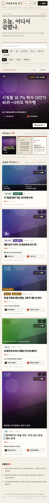

---

## 1. 무엇을 바꿨나 (v9 → v10) — 2026-11-25

사용자 지적: *"이슈 온도계는 좋았는데, 좀 분야 다양하게 어그로 끌 수 있는 내용으로 홍보하게 해주고. 카드뉴스 처음에는 썸네일을 이미지로 무조건 해주고, 이미지가 그냥 색깔만 채우는 게 이미지가 아니라 진짜 이미지로 채워주고, 두 번째·세 번째·네 번째 페이지도 이미 아니면 너무 AI틱으로 PPT식으로 만들지 말고, 진짜 인스타에 후킹한 채널들 있지. 그런 식으로 해줘."*

| v9의 문제 | v10 |
| --- | --- |
| 사진이 없거나 프록시가 막히면 **단색·그라데이션 4:5 캔버스**로 때움 — "색깔만 채우는 이미지" | **단색 폴백을 없앴습니다.** ① 기사 대표 사진 → ② 기사 페이지 대표 사진(og:image) → ③ **분야별 실사 사진 풀 18장**(`public/photos`, 연예·사회·문화·테크·경제·직장 각 3장) 순서로 **반드시 사진이 깔립니다**. 자료사진을 쓸 때는 카드에 `자료사진`이라고 적습니다 |
| 언론사 사진은 800×450 정도라 4:5로 늘리면 **3배 확대돼 뿌옇게** 보임 | 작은 가로 사진은 **사진 창(window)** 으로 그립니다 — 카드 전체는 같은 사진을 흐린 배경으로 깔고, 가운데에 원본 비율 그대로의 **선명한 사진 띠**를 놓습니다. 세로 사진(1080×1350)은 그대로 풀블리드 |
| 4번 카드가 **색 블록 두 개에 두 단어** = PPT | 4번은 **사진 띠(A·VS·B 큰 활자) + 종이 지면을 세로 괘선으로 가른 두 진영**으로 다시 지었습니다. 색 블록 없이 활자와 괘선만 |
| 2·3·5번도 텍스트 상자 나열 | 2번은 사진 띠 위 헤드라인 + 번호 붙은 팩트 3줄, 3번은 **사진 전체 위 큰 인용/배경 + 화면 끝까지 닿는 '핵심 쟁점' 종이 띠**, 5번은 사진 위 질문 + A/B + **강조색 댓글 유도 바** |
| 표지가 한 판(훅+그라데이션)뿐 | **표지 판 5종** — 포토 헤드라인 · 한마디(실제 인용) · 숫자 · 포토 스트립 · 속보. 서버가 카드마다 다른 판을 배분하고, 그 판을 그릴 수 있는 카드(숫자가 있는 카드만 숫자 판, 인용이 있는 카드만 한마디 판)에만 줍니다 |
| 분야가 사회·경제에 몰림 | 수집원 **19곳 → 23곳**(조선일보 연예, 머니투데이, 한국경제, 노컷뉴스 추가) + 분야 최소 자리(연예2·사회2·문화1·테크1·경제1·직장1) + 프롬프트에 "최소 4개 분야" 규칙 |
| 헤드라인이 보도체 그대로("25일 …에 따르면 …밝혔다") | 훅 규칙을 프롬프트에 박았습니다 — 34자 이내, **날짜·기관명으로 시작 금지, "~밝혔다/전했다" 종결 금지**, 숫자 대비·반전·손해/이득 중 최소 하나. AI가 없을 때도 **보도체 문장은 '핵심 쟁점'에서 빼고** A/B 질문이 그 자리를 채웁니다 |
| Gemini가 붐빌 때("high demand") 한 번 실패하면 전부 헤드라인 카드로 떨어짐 | AI 호출을 **한 번 재시도**합니다(429/5xx/과부하일 때만, 남은 시간이 있을 때). 카드 품질이 통째로 갈리는 지점이라 |
| 이미지 프록시 허용 목록이 19곳뿐 | 포털·방송사·연예 매체 CDN까지 넓히고, **`&amp;`가 남은 사진 주소를 디코드**해 400이 나던 조선일보 사진을 살렸습니다(리다이렉트 도착지도 공개 주소인지 검사) |

### 카드 5장, 이렇게 달라졌습니다

| ① 표지 | ② 무슨 일인데 | ③ 왜 지금 뜨나 | ④ 어디서 갈렸나 | ⑤ 당신의 선택 |
| --- | --- | --- | --- | --- |
| 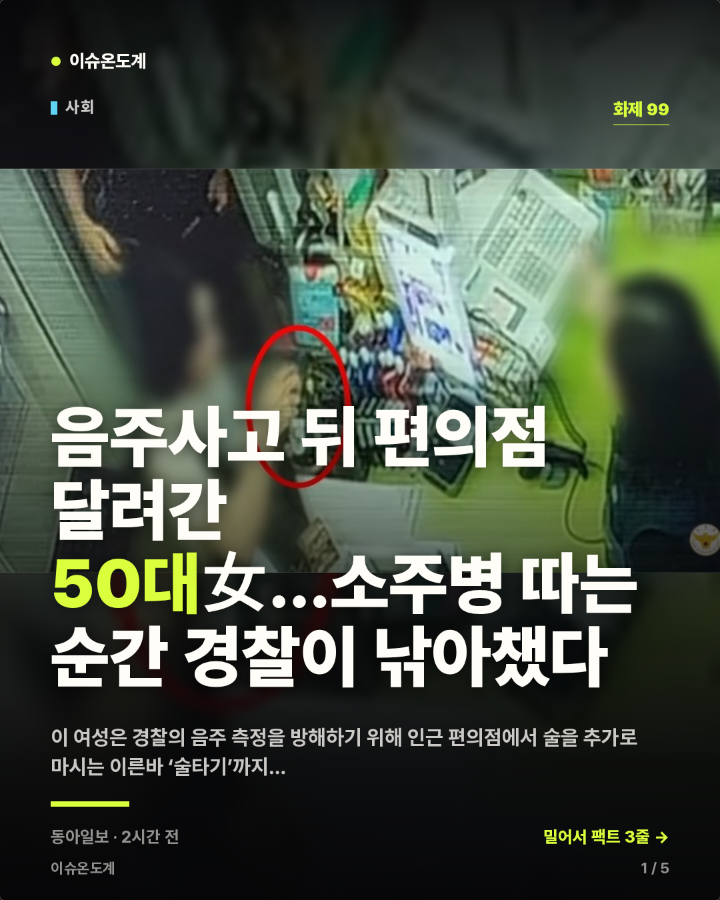 | 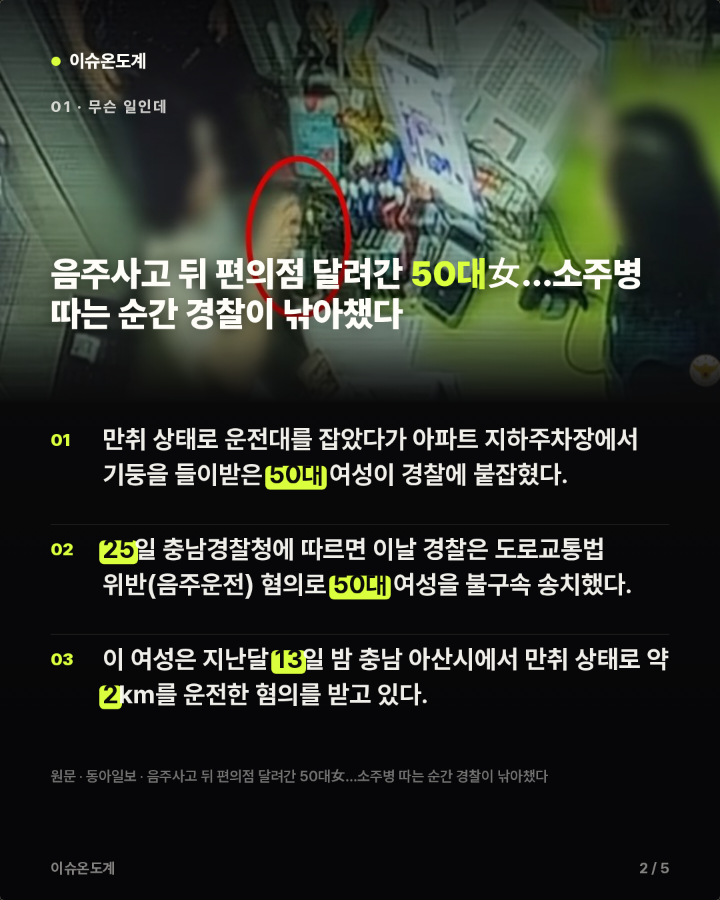 | 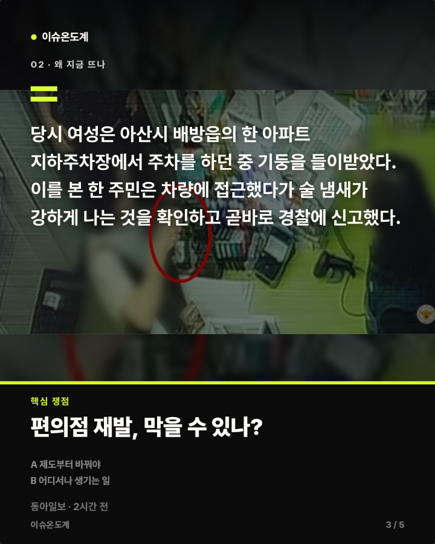 | 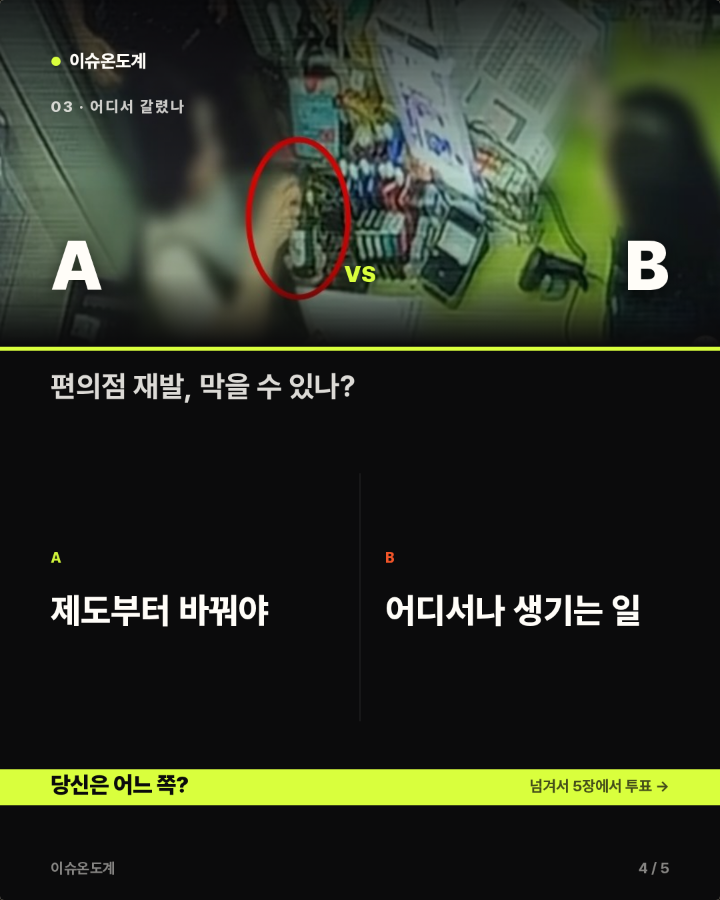 | 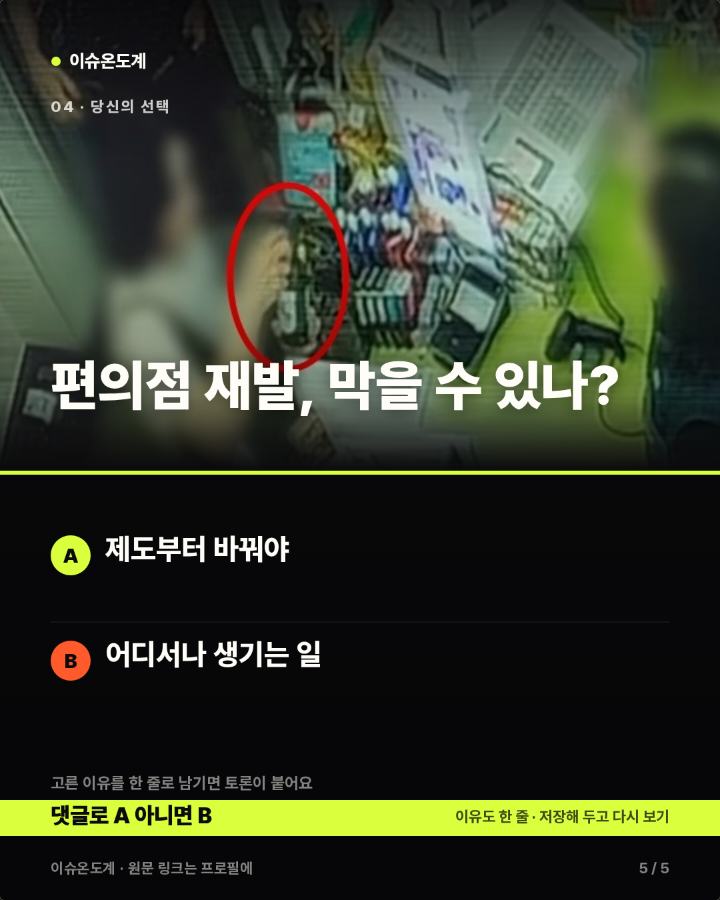 |

---

## 1-0. (이전) v7 → v8 — 2026-11-24

사용자 지적: *"이거 진짜 사람들이 돈 주고 쓸 수 있을 정도야? AI가 만든 티가 나잖아. 토스트가 버튼을 가리고, 탭 글자는 잘리고. 요금제도 있어야지."*

| v7의 약점 | v8 |
| --- | --- |
| 검정 바탕 + 형광 라임 글로우 = 어디서나 본 AI SaaS 템플릿 | **인쇄 매거진 문법**으로 다시 지었습니다. 종이(`#f4f0e6`)·먹(`#17160f`)·주홍 한 점(`#bf361f`), **세리프 헤드라인**(Noto Serif KR), 1px 괘선과 모노 라벨, 3px 각진 버튼. 형광색·글로우·그라데이션 장식은 걷어냈습니다. 카드(캔버스)는 그대로 매거진 테마 4종 |
| 토스트가 모달 하단 버튼을 덮음(19b 스크린샷) | 토스트는 **버튼을 가리지 않는 자리**로 갔습니다 — 모달이 열려 있으면 맨 위, 아니면 상단 바 바로 아래. `pointer-events:none`이라 밑의 버튼은 그대로 눌립니다. 부모가 다시 그려질 때마다 사라지지 않고 시간이 초기화되던 버그도 고쳤습니다 |
| 카드 5장 탭 라벨이 잘림(`⑤ 당신...`) | 탭을 **3+2 그리드**(데스크톱 5열)로 바꾸고 라벨을 `① 표지 ② 팩트 ③ 쟁점 ④ A vs B ⑤ 투표`로 줄였습니다. 전체 이름은 탭 아래 안내줄에 그대로 나옵니다 — 잘리는 글자 0 |
| 문구를 고치려면 모달을 닫고 카드를 다시 열어 확인 | **2단 편집실** — 왼쪽에서 고치면 오른쪽 **실시간 4:5 미리보기**가 같은 캔버스로 다시 그려집니다(저장 전에도). 모바일은 편집 칸 위에 미리보기를 둡니다 |
| 인스타에 올렸을 때 내 피드에서 어떻게 보일지 알 수 없음 | **인스타 3×3 피드 미리보기** — 방금 만든 표지가 최근 카드들과 나란히 놓인 모습을 실제로 그린 표지로 보여 줍니다(맨 앞 칸에 주홍 테두리) |
| 무료/유료 구분이 없어 "팔 수 있는가"에 답이 없음 | **요금제 3단** — Free(0원) / Creator Pro(월 14,900원) / Team Studio(월 39,000원), **월·연 토글(연 결제 = 2개월 무료)**, 9행 기능 비교표, **Creator Pro 7일 무료 체험(결제 연동 전 데모)**. 잠금은 화면 장식이 아니라 실제 동작입니다 |
| 기능을 잠가도 왜 잠겼는지 알 수 없음 | 잠긴 버튼에는 자물쇠 + `Pro` 표시가 붙고, 누르면 **요금제가 열립니다**. 편집실 하단에는 지금 플랜(`Free · 카드 1장 PNG`)이 항상 보입니다 |

### 실제로 잠기는 것

| 기능 | Free | Creator Pro · Team |
| --- | --- | --- |
| 카드 5장 생성·1장 PNG | O | O |
| 5장 ZIP 한 번에 | 잠금(요금제로 안내) | O |
| @내 핸들 워터마크 | 잠금(이슈온도계가 박힘) | O |
| 매거진 테마 | 에디토리얼 1종 | 4종 전체 |
| AI 캡션·해시태그 | 기본 캡션(태그 5개) | 3줄 요약 + 태그 12~15개 |

- Pro에서 Free로 내려거나 체험을 끄면 **카드가 곧바로 기본 테마·기본 워터마크로** 돌아갑니다(저장해 둔 값은 지우지 않고 잠그기만).
- 결제는 아직 붙이지 않았습니다. `src/lib/plan.ts`의 `priceId` 자리에 상품 ID를 넣고 `checkoutTarget()`을 체크아웃에 연결하면 화면·잠금 판단은 그대로 씁니다. 그전까지는 **무료 체험 토글**만 실제로 동작합니다.

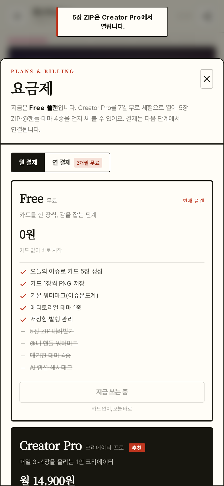

### 편집실 2단 — 고치는 즉시 카드가 보입니다

| 모바일 (미리보기 위 + 3×3 피드) | 데스크톱 (편집 / 미리보기) |
| --- | --- |
| 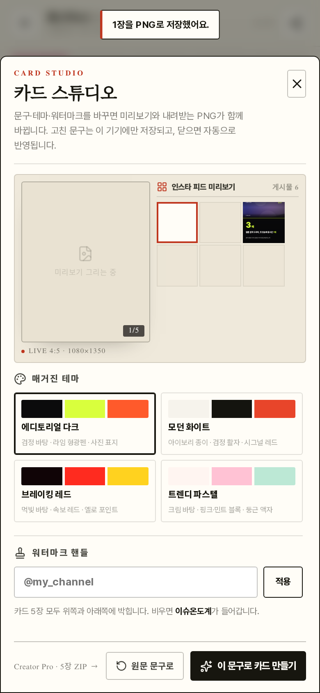 | 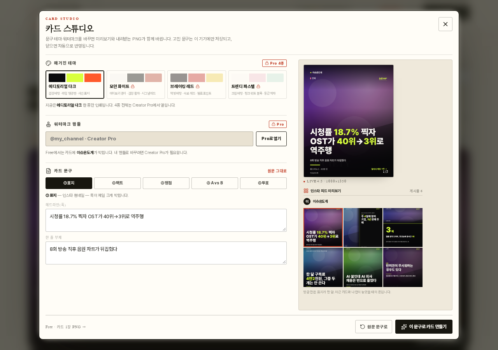 |

---

## 1-0. (이전) v6 → v7

v6는 "보여 주는 카드"까지는 됐지만, **매일 3~4장을 올리는 크리에이터의 손과 습관**이 빠져 있었습니다. 카드 문구는 AI가 뽑은 그대로였고, 디자인은 한 가지였고, 무엇을 이미 올렸는지 앱은 기억하지 못했습니다.

| v6의 약점 | v7 |
| --- | --- |
| 카드 문구를 고칠 수 없음 — 어색한 AI 문장도 그대로 PNG에 박힘 | **카드 스튜디오(문구 편집실)**: ① 훅·부제 ② 팩트 3줄 ③ 배경·핵심 쟁점 ④ A/B 진영 이름·주장 ⑤ 투표 질문·선택지까지 5장 전 문구를 고치고, **닫으면 카드에 자동 반영**. 카드별 편집값은 localStorage에 남고 `원문 문구로` 되돌리기 가능 |
| 카드 디자인이 '검정+라임' 한 가지 | **매거진 테마 4종** — 에디토리얼 다크(검정·라임 형광) · 모던 화이트(아이보리 종이·검정 활자·시그널 레드) · 브레이킹 레드(먹빛·레드 띠·옐로) · 트렌디 파스텔(크림·핑크·민트·둥근 액자). 색을 **역할(바탕·글자·강조 면·강조 글자·사진 위 글자·스크림)** 로 나눠 정의해, 밝은 테마에서도 형광 하이라이트·칩·버튼이 읽힙니다 |
| 내 채널 표시가 없음 | **@핸들 워터마크**가 5장 모두 위·아래에 박힘(`@my_channel`). localStorage에 유지, 비우면 서비스명 |
| 캡션이 자동 생성문 하나뿐 | **인스타 캡션 생성기**: 훅 → 3줄 요약 → 쟁점 → A/B 토론 질문 → 링크 → **해시태그 12~15개**(서비스·카테고리·기사 키워드·범용). 직접 고치고 `다시 생성`, 2,200자 카운터, 원클릭 복사 |
| 하루 3~4장 올리는 흐름을 관리할 도구가 없음 | **크리에이터 작업 줄**: 제목·키워드·출처·팩트 **검색**, 카테고리 5종 필터, **저장함 / 발행 전 / 발행 완료** 필터, **오늘 발행 n/4** 게이지, 카드마다 저장·발행 완료 단추. 새로고침해도 유지(localStorage) |
| 투표 결과가 숫자만 | **표 수 + % + 채워지는 막대**(투표 전에는 숨김 → 편향 방지), 투표 직후 **한 줄 반응 입력 + 빠른 반응 칩 4개**로 토론이 바로 붙음 |
| RSS·이미지가 한 번 실패하면 화면이 빔 | 수집 실패 시 **직전 카드 유지 + '새로고침' 배너**, 기사 사진 실패 시 **`/api/img` 프록시로 1회 재시도 → 그래픽 포스터**, 카드 로딩 shimmer, 폰트 1회 캐시, **5장 병렬 렌더** |
| 키·개인정보가 코드에 섞일 위험 | API 키는 환경변수에서만(`GEMINI_API_KEY`/`OPENAI_API_KEY`), 브라우저 저장값은 테마·핸들·카드 문구·캡션·저장함뿐 — 실명·연락처·계정을 담지 않습니다 |


---

## 1-1. (이전) v5 → v6

사용자 지적: *"5 훨씬 나아졌는데 내가 보는 썸넬은 카드뉴스 칸에 없어 맨처음 인스타 썸네일은 그걸로 주목 받아야 하잖아 그리고 2페이지부터 텍스트만 있어서 너무 피피티 같아 인스타 핫뉴스 카드뉴스처럼 만들어줘 이미지 필요하면 넣고 하루에 3-4개 올리는 거 적당한데 유명해지고 광고까지 할만한 기사, 어그로성 기사들도 모아줬음 좋겠어"*

| v5 (지적받은 것) | v6 |
| --- | --- |
| 카드뉴스 1번이 글자만 있는 검정 표지 — 피드에서 보던 기사 사진(썸네일)이 카드뉴스 칸에는 없음 | **1번 = 인스타 썸네일**. 기사 사진을 4:5로 꽉 채우고 진한 그라데이션·그림자를 깐 뒤, 90~104px 훅 헤드라인(숫자는 라임 강조)·핫 배지(논란 74°/화제 91)·카테고리 칩·출처·시간을 얹습니다. 사진이 없는 기사는 카테고리 색 포스터+망점으로 채웁니다 |
| 2페이지부터 텍스트만 덩그러니 = "PPT 같다" | 5장 전부 **매거진 조판**으로 다시 그렸습니다 — ② 사진 띠 + 번호 카드 3개(숫자는 형광펜), ③ 사진 카드 + 인용 + 핵심 쟁점 박스 + A/B 라벨 칩, ④ 라임·주황 대결 패널 + VS 배지, ⑤ 사진 위 질문 + 라임 패널 + A/B 선택지 + **댓글 유도 엔딩 카드** |
| 화면 미리보기(DOM)와 저장 PNG(캔버스)가 따로 놀아 미세하게 다름 | **미리보기 = 저장본**. 5장을 캔버스로 그려 그 이미지를 화면에 그대로 띄우고, 저장은 같은 blob을 내려받습니다. `npm run verify`가 **화면 5장 ↔ PNG/ZIP 해시 일치**를 대조합니다 |
| 표지가 기사 사진을 못 쓰는 경우가 있음(언론사 이미지 서버가 CORS를 막으면 캔버스가 오염) | **`/api/img` 사진 프록시** — 언론사 19곳의 이미지 도메인만 열어 주고(사설망·file:// 차단, image/* 4MB·8초 상한), 같은 출처로 받아 캔버스에 안전하게 그립니다 |
| 점잖은 스트레이트 뉴스 위주 | RSS **13곳 → 19곳**(연합뉴스 연예·사회, SBS 사회·문화, 조선일보, 매일경제 추가) + **화제성(0~99) 채점**: 논란·사건·연예·생활비·단독/속보 키워드, 숫자·물음표, 최신성, 사진 유무로 점수를 매기고 인사·협약·정례 같은 알림성 기사는 크게 깎습니다. 목록·카드·정렬이 모두 화제성 기준 |
| 하루 몇 장을 올려야 할지 감이 없음 | **"오늘 올릴 카드"** 배지로 상위 4장을 표시하고, 피드는 `화제성 순`으로 정렬합니다. 카드마다 `화제 91`(제목·키워드 기반)을 숫자로 보여 줍니다 |
| AI 응답이 길어져 JSON이 잘리면 카드가 0장이 되어 전부 헤드라인으로 내려감 | **잘린 JSON 복구**(완성된 카드 객체만 건져 냄) + `pick`이 틀려도 **제목으로 후보 기사 매칭** — AI가 조금 삐끗해도 카드가 살아남습니다 |

---

## 1-2. (이전) v4 → v5

사용자 지적: *"투표하는 거, A, B 고르는 거 계속 똑같은 것만 나와. 지금 조개 중요해? 아예 자극적인 걸로 해달라고. 그리고 이거 너무 PPT로 만든 것 같지 않아? 폰트나 글자체 좀 바꿔줘. 구성도 좀 바꿔주고, 너무너무 재미없고 밋밋하잖아."*

| v4 (지적받은 것) | v5 |
| --- | --- |
| 투표가 카드마다 비슷하거나 밋밋함 — AI가 실패하면 5장이 모두 같은 문항(`이 뉴스, 내 일상에 영향 있나요?`) | **이슈별 논쟁 엔진**(`api/debate.ts`) — 제목에서 주제어와 갈등 유형(물가·규제·노동·채용·논란·테크·정책·문화·안전·소비·서비스)을 읽어 그 기사에만 통하는 양자택일을 만듭니다. AI 문항이 밋밋하거나(`찬성/반대`, `어떻게 보시나요`) 다른 카드와 겹치면 **자동으로 새 문항으로 교체**하고, 한 화면에서 선택지가 절대 겹치지 않게 마지막까지 맞춥니다 |
| 조개 시세 같은 동네 단신이 '오늘의 이슈'로 올라옴 | 관심 키워드가 하나도 없는 기사는 점수를 크게 깎고, **시세·경매·어획·출하량 같은 단신은 제외** |
| 명조체 + 베이지 바탕 + 둥근 박스 나열 → PPT 같음 | **검정 바탕 + Pretendard/SUIT 큰 고딕 + 형광 라임**의 매거진 레이아웃. 히어로는 화면 끝까지 붙는 풀블리드, 목록은 사진이 먼저 보이는 4:5 카드 피드, 온도는 그라데이션 게이지로 |
| 투표 문항이 카드를 열어야만 보임 | **피드 카드마다 A/B 문항과 선택지가 그대로 보입니다** — 목록만 봐도 카드마다 다른 질문이라는 게 확인됩니다 |
| 카드뉴스 5장을 열어야만 구성이 보임 | 히어로 아래 **카드뉴스 5장 미리보기** — 누르면 그 장부터 뷰어가 열립니다 |
| 카드뉴스가 밋밋한 슬라이드 | ①표지(검정) ②팩트(아이보리) ③쟁점(검정) ④A vs B(라임·주황) ⑤투표(라임 포스터) — 흑백을 끊어 읽는 카드뉴스로 다시 조판(화면·PNG 모두) |

### 이슈별 A/B가 어떻게 다른가 (예시)

| 기사 | v4 (반복) | v5 |
| --- | --- | --- |
| 편의점 도시락 12% 인상 | 이 뉴스, 내 일상에 영향 있나요? | **도시락 12% 인상, 그냥 넘어갈까?** · A `안 산다, 다른 데 간다` / B `원가 탓, 이해한다` |
| 4대 은행 깡통대출 5조 | 〃 | **깡통대출, 이대로 괜찮나?** · A `아니다, 바뀌어야` / B `괜찮다, 과하다` |
| 서울대 일회용 가운 | 〃 | **일회용 가운 소식, 남 일 같나?** · A `내 일이다, 준비한다` / B `아직은 괜찮다` |
| 안보 홍보 음모론 유튜버 | 〃 | **음모론 유튜버, 결국 덮이나?** · A `덮으면 더 커진다` / B `시간이 약이다` |

---

## 1-3. (이전) v3 → v4

사용자 지적: *"불필요하게 만들어줬어. 카드뉴스로 인스타에 올려서 주목을 받아야 하는데, 내용도 제대로 정리 안 돼 있지 않아? 뉴스도 제대로 안 들어가 있고."*

| v3 (지적받은 것) | v4 |
| --- | --- |
| 뉴스가 부실 — RSS 7곳 중 5곳이 연합뉴스, 요약이 짧으면 카드도 빈약 | **RSS 13곳**(연합뉴스 5개 섹션·경향·동아·동아경제·오마이뉴스·SBS·SBS경제·블로터·전자신문) + 후보 16건·본문 최대 12건 확인 |
| 팩트 2줄 + 양쪽 입장뿐 | **카드 5장** — ① 표지 훅 ② 팩트 3줄 ③ 왜 지금 뜨나·핵심 쟁점 ④ A vs B 대립 ⑤ 한 줄 팩폭·투표 질문 |
| 화면 비율이 제각각, 인스타에 못 올림 | **4:5 (1080×1350) 고정** + **현재 장 PNG 저장** + **5장 ZIP 한 번에** + **인스타 캡션·해시태그 원클릭 복사** |
| 한 줄 반응만 카드 안에 | 카드 아래 **A/B 진영을 고른 토론 댓글 + 공감 + 진영 필터** (서버 저장, 끊기면 이 기기에 저장) |
| HTML 태그·기자 머리말·사진 캡션·깨진 문자 섞임 | **전용 정제기** — 태그·저작권·`(서울=연합뉴스) 홍길동 기자 =`·`[사진]`·제로폭 문자 제거, 문장 단위로 자르고 단어 중간에서 끊지 않음 |
| 같은 사안을 여러 매체가 받아쓴 기사가 카드로 중복 | 제목 접두 18자 중복 제거 + **비슷한 문장(같은 팩트) 판별**로 팩트 3줄이 겹치지 않게 |

---

## 2. 화면

### ① 오늘의 카드뉴스 피드 (모바일)

- 상단에 **오늘의 표제**("오늘, 어디서 갈렸나")가 **세리프 큰 활자**로 서고, 1위 이슈는 화면 끝까지 붙는 **풀블리드 히어로**로 올라갑니다(사진 위 큰 헤드라인 + 온도 + A/B).
- 그 아래 **카드뉴스 5장 미리보기** — **1번 칸은 실제로 그린 표지(인스타 썸네일)**가 그대로 보이고, 다른 칸도 누르면 그 장부터 열립니다. 이어서 사진이 먼저 보이는 **카드 피드**(번호·카테고리·화제성·A/B 문항·투표/댓글 현황).
- 상단 띠에 **수집 시각 · 이슈 건수 · AI 상태 · 연결된 언론사 수**를 그대로 적습니다(숨기지 않음).

### ② 카드뉴스 5장 (4:5)

| 표지 | 무슨 일인데 (팩트 3줄) | 왜 지금 뜨나 · 쟁점 |
| --- | --- | --- |
|  | 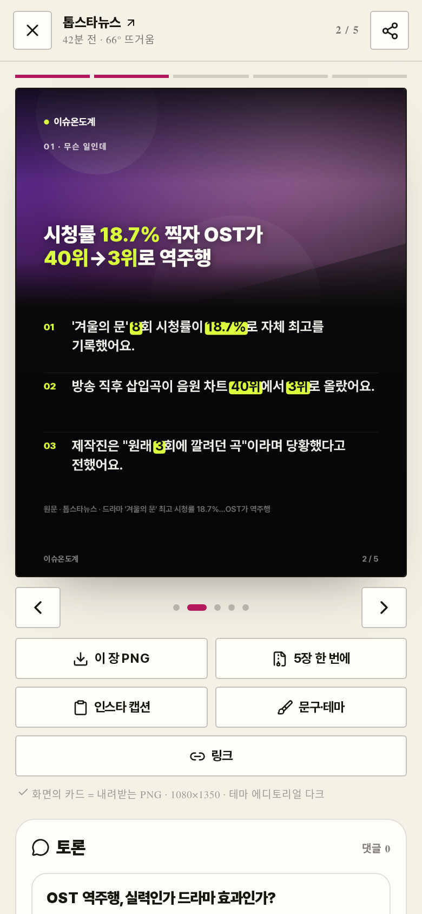 | 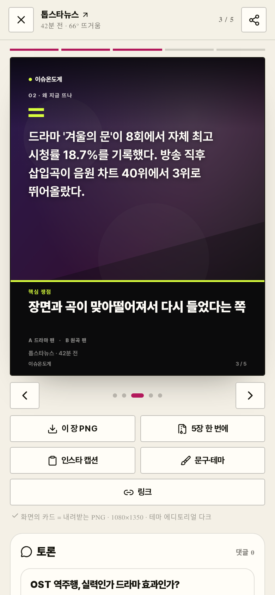 |

| A vs B | 투표 · 댓글 유도 |
| --- | --- |
| 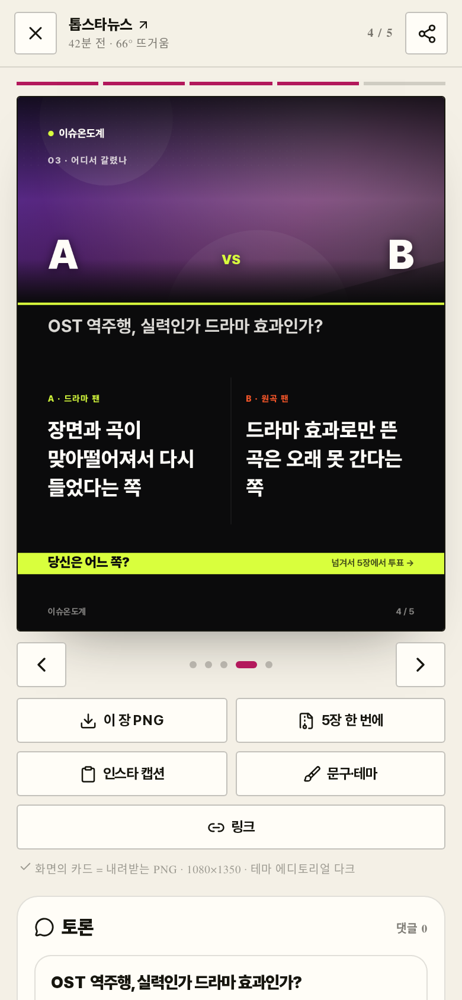 | 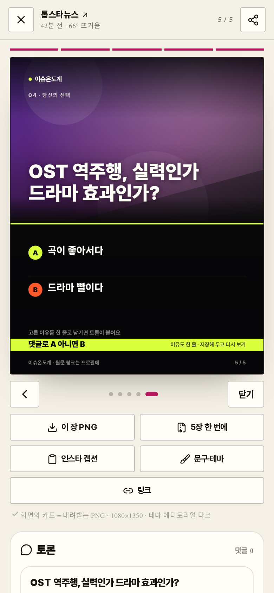 |

실제 수집 기사로 그린 카드 5장(v10). 다섯 장 모두 **실제 사진 위에 조판**되고, 표지는 이슈마다 다른 판(포토 헤드라인·한마디·숫자·포토 스트립·속보)으로 그립니다:

| ① 표지 | ② 무슨 일인데 | ③ 왜 지금 뜨나 | ④ A vs B | ⑤ 당신의 선택 |
| --- | --- | --- | --- | --- |
|  |  |  |  |  |

- **손끝·마우스로 끌면 카드가 그대로 따라 밀립니다.** 버튼을 눌렀을 때만 툭 넘어가던 방식을 없애고, 끄는 동안 `translateX`가 실시간으로 따라오다가 손을 떼면 이동 거리·속도(짧게 튕기기)에 따라 다음·이전 장으로 부드럽게 스냅합니다.
- 화살표·키보드(←/→)·진행 막대·아래 점으로도 같은 애니메이션으로 이동합니다.
- 카드 안을 세로로 스크롤할 때는 스와이프로 오인하지 않고, 첫 6px에서 가로/세로를 판별합니다(안드로이드 크롬 `touch-action: pan-y`).


### ③ 인스타에 바로 올리기 — PNG · ZIP · 캡션

- **이 장 PNG**: 지금 보고 있는 장을 1080×1350 PNG로 저장합니다(캔버스에 직접 그려 화면 캡처보다 선명).
- **5장 한 번에**: 5장을 ZIP 파일 하나로 저장합니다(폰에서 여러 번 저장이 막히는 문제 회피).
- **인스타 캡션**: 훅 → 팩트 3줄 → 쟁점 → 투표 질문 → 카드 링크 → 해시태그까지 한 번에 복사.


저장된 원본 PNG(1080×1350):

| 표지 | 팩트 | A vs B |
| --- | --- | --- |
|  |  | 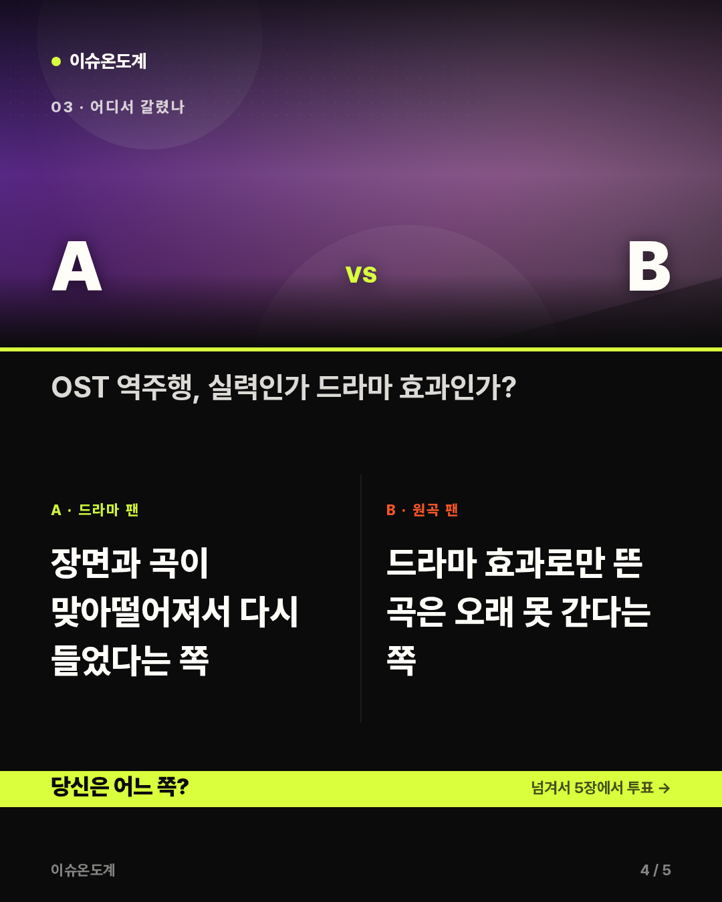 |

### ④ 카드 아래 투표 + 토론


- A/B를 누르면 **퍼센트 바와 누적 참여 수**가 갱신되고, 다시 누르면 바뀝니다.
- 댓글은 **A쪽/B쪽 진영을 고른 뒤** 남깁니다. 목록에서 진영·익명 꼬리표·시간·**공감**이 보이고, 전체/A/B로 필터할 수 있습니다.
- 공용 저장소가 없거나 연결이 끊기면 **이 브라우저(localStorage)에 내 표·댓글·공감이 남고** 화면에 그 사실을 적습니다.
- **공유하기**(모바일 공유 시트) / **링크 복사** → `.../#/i/<카드id>` 로 받은 사람은 그 카드와 토론이 바로 열립니다.

### ⑤ 뉴스로 만들기 — 기사 링크 또는 한 줄


- 언론사 기사 **URL을 넣으면 서버가 본문을 직접 읽어**(SSRF 차단) 같은 5장 형식의 카드를 만듭니다.
- 링크 없이 "요즘 편의점 도시락 가격 왜 이래" 같은 **한 줄**로도 카드가 만들어집니다.

### ⑥ AI가 없을 때도 정직하게

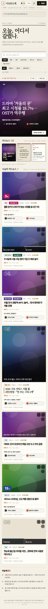

- AI 키가 없으면 **실제 헤드라인·요약 그대로** 카드를 만들고 `AI 없이 제목` 배지와 `온도 미측정`을 표시합니다.
- 팩트 3줄은 기사 요약 문장에서 채우되, 없는 수치를 만들지 않습니다. 양쪽 입장 정리가 없으면 숨기지 않고 그렇다고 적습니다.

### ⑧ 카드 스튜디오 — 문구 · 테마 · 워터마크 (2단 + 3×3 피드)

카드뉴스 뷰어의 `문구·테마` 버튼 또는 상단의 테마 칩으로 엽니다. 데스크톱에서는 **왼쪽 편집 · 오른쪽 실시간 미리보기** 2단, 모바일에서는 미리보기가 편집 칸 위에 옵니다. 테마·워터마크·문구를 바꾸면 **같은 캔버스로 미리보기가 바로 다시 그려지고**, 그 아래 3×3 인스타 피드에서 방금 만든 표지가 최근 카드들과 어떻게 놓이는지 보입니다. 문구는 장별 탭(①~⑤)에서 고친 뒤 닫으면 반영됩니다(저장 전 수정은 `n칸 수정 · 저장 전`).


| 테마 | 생김새 |
| --- | --- |
| 에디토리얼 다크 | 검정 바탕 + 라임 형광펜 + 사진 표지 |
| 모던 화이트 | 아이보리 종이 + 검정 활자 + 시그널 레드, 브랜드 아래 머리선 |
| 브레이킹 레드 | 먹빛 바탕 + 위쪽 레드 띠 + 옐로 배지 |
| 트렌디 파스텔 | 크림 바탕 + 핑크·민트 블록 + 둥근 액자 |

같은 표지를 테마만 바꿔 뽑은 예: [모던 화이트](docs/screenshots/creator-theme-modern.png) · [브레이킹 레드](docs/screenshots/creator-theme-breaking.png) · [트렌디 파스텔](docs/screenshots/creator-theme-pastel.png)

### ⑨ 작업 줄 — 검색 · 저장함 · 발행 완료


### ⑩ 데스크톱


---

## 3. 동작 방식

```
[언론사 RSS 19곳]  ← 서버가 병렬로 fetch (8초 타임아웃, 실패한 피드는 건너뜀)
      ↓ 제목·요약·발행시각·원문 링크·대표 이미지 파싱 + 기자 머리말·사진 캡션·저작권 문구 제거
[오늘 기사 후보]   ← 26시간 이내 + 제목/접두 중복 제거 + 관심 키워드 점수 + **화제성(0~99)**
      ↓ 카테고리가 몰리지 않게 라운드로빈으로 20건
[본문 확인]        ← 요약이 짧은 상위 12건을 동시 6건씩 읽어 사실 근거로 사용(전체 12초 예산)
      ↓
[AI 카드 생성]     ← Gemini(무료 키) 또는 OpenAI — 5~6건을 골라 5장 구성으로 정리
      ↓ 12분 캐시(Upstash/Supabase/메모리)
[피드 + 투표·토론]  ← A/B 집계와 댓글은 /api/poll 로 공용 저장
```

- **수집원(23곳)**: 연합뉴스(종합·경제·산업·문화·정치·**연예·사회**), 경향신문, 동아일보(종합·경제), 오마이뉴스, SBS(종합·경제·**사회·문화/라이프**), 블로터, 전자신문, 조선일보(**연예**), 매일경제, **머니투데이, 한국경제, 노컷뉴스**.
- **사진**: 카드 5장은 ① RSS 대표 사진 → ② 기사 페이지 og:image → ③ 분야별 실사 사진 풀(`public/photos`) 순서로 **반드시 사진을 깔고** 그립니다. 작은 가로 사진은 흐린 배경 + 선명한 사진 창으로, 자료사진을 쓰면 카드에 `자료사진`이라고 적습니다.
  모두 제목·요약·원문 링크·발행시각을 함께 주는 RSS입니다. Google 뉴스 RSS는 요약이 링크뿐이라 **사실 근거로 쓸 수 없어 넣지 않았습니다**.
  사진이 붙는 피드를 우선했고, 막힌 피드는 응답의 `feeds`에 `ok:false`로 정직하게 표시됩니다.
- **화제성(0~99)** `buzzOf()`: 제목의 논란·사건·연예·생활비 키워드와 단독/속보, 숫자·물음표, 최신성, 사진 유무로 점수를 매기고, 인사·협약·개막·정례 같은 알림성 기사는 크게 깎습니다. 카드 정렬·`화제 91` 표시·"오늘 올릴 카드" 배지가 모두 이 점수를 씁니다. **사실은 건드리지 않고 무엇을 위로 올릴지만 정합니다.**
- **AI 프롬프트 원칙**: 주어진 기사에 없는 수치·기관·인물·회사·날짜를 만들지 말 것 / 확인되지 않은 추측 금지 / 카드당 1~2문장 / 팩트는 서로 다른 내용 3개 / 투표는 정답 없는 양자택일.
- **A/B 문항 엔진**(`api/debate.ts`): AI가 준 문항이 ①어느 기사에나 붙는 상투구이거나 ②앞 카드와 선택지가 같으면, 그 기사의 제목·요약에서 주제어(따옴표 표현 → 키워드 → 제목 앞 구절)와 갈등 유형을 읽어 새 문항을 만듭니다. 그래도 겹치면 주제어를 선택지에 넣어 확실히 다른 문항으로 마무리합니다. **AI가 아예 없을 때도 카드마다 다른 문항**이 나갑니다.
- **AI가 실패하면**: 실제 헤드라인 카드로 자동 폴백(`ai:false`). 앱은 그 사실을 표시합니다.
  응답 JSON이 중간에 잘려도 `salvageIssues()`가 완성된 카드만 건져 내고, `pick`이 틀려도 AI가 함께 준 제목으로 후보를 다시 찾습니다.
- **카드 그리기**: `src/lib/cardImage.ts` 하나가 5장을 캔버스(1080×1350)로 그립니다. 사진은 `/api/img`(같은 출처) → 원본(CORS 허용 시) 순으로 시도하고, 없으면 카테고리 색 포스터로 그립니다. 화면 미리보기도 이 캔버스 결과를 그대로 쓰고, 저장은 같은 blob을 내려받습니다.

---

## 4. API

### `GET /api/trending`
```jsonc
{
  "ok": true, "mode": "shared", "store": "redis",
  "ai": { "provider": "gemini", "model": "gemini-3.5-flash-lite" },
  "generatedAt": 1794834907764, "stale": false,
  "feeds": [{ "name": "연합뉴스 종합", "ok": true }, ...],
  "issues": [{
    "id": "1b5td2e1u0h",
    "category": "work",                       // work | mz | money | tech | culture
    "title": "직장인 10명 중 6명 \"점심값 1만5천원 넘으면 부담\"",
    "source": "연합뉴스", "url": "https://www.yna.co.kr/view/...",
    "publishedAt": 1794829867000, "image": "https://img.yna.co.kr/...",
    "hook": "점심값 1만5천원, 이제 월급에서 빠지는 고정비",
    "kicker": "직장인 58%가 \"1만5천원 넘으면 부담\"",
    "facts": ["...", "...", "..."],           // 정확히 3줄 (부족하면 기사 문장으로 채움)
    "background": "왜 지금 떴는지 2문장",
    "point": "무엇을 두고 갈리는지 한 줄",
    "sides": { "labelA": "식당 쪽", "labelB": "직장인 쪽", "a": "...", "b": "..." },
    "poll": { "question": "점심값 1만5천원, 순순히 낼 수 있나?",   // 이 카드에만 통하는 문항
              "a": "이제 점심도 사치다", "b": "그 정도는 낸다" },
    "temp": 74, "buzz": 91,                    // 제목·키워드로 계산한 화제성(0~99)
    "tags": ["점심값", "물가", "직장인"], "ai": true
  }]
}
```
- `?refresh=1` 새로 긁기, `?issue=<id>` 카드 하나 다시 꺼내기.
  카드는 하나씩 따로 **7일 보관**하므로, 받은 사람이 며칠 뒤에 링크를 열어도 그 카드가 뜹니다(캐시가 새로 바뀌어도 유지).
- 피드를 하나도 못 읽으면 `503 feeds_unreachable`, 없는 카드는 `404`.

### `GET /api/img`
```
GET /api/img?u=<기사 사진 주소>
→ image/jpeg 등 원본 그대로 (Cache-Control: public, max-age=86400)
```
- 카드뉴스 표지에 기사 사진을 그리기 위한 **같은 출처 통로**입니다. 언론사 이미지 서버가 CORS를 막아도 캔버스가 오염되지 않아 PNG 저장이 됩니다.
- **언론사 19곳이 쓰는 이미지 도메인만** 허용(그 밖의 호스트 `400`), `http(s)`만, 사설망·메타데이터·`file://` 차단, `image/*` 4MB·8초 상한.

### `POST /api/briefing`
```jsonc
{ "url": "https://www.yna.co.kr/view/...", "text": null }   // 또는 { "text": "궁금한 이슈 한 줄" }
→ { "ok": true, "engine": "ai", "ai": { "provider": "gemini", "model": "..." }, "issue": { ... } }
```
- `engine: "headline"` 이면 AI 없이 제목·첫 문장만으로 만든 카드(이유가 `notice`에 담깁니다).
- 오류: `400 too_short` / `400 google_news_link` / `400 article_unreadable`(사설망·메타데이터·비HTML 포함) / `413 too_long` / `429 rate_limited`.

### `GET·POST /api/poll`
```jsonc
GET  /api/poll?ids=<id1>,<id2>&voterId=<익명id>
→ { "ok": true, "mode": "shared", "polls": { "<id>": {
      "question": "...", "a": "...", "b": "...",
      "counts": { "a": 3, "b": 1 }, "total": 4, "my": "a", "commentCount": 2,
      "comments": [{ "id": "c...", "side": "b", "text": "이건 좀 심하다",
                     "at": 1794834900000, "tag": "1ytt", "likes": 1,
                     "liked": true, "mine": false }] } } }

POST /api/poll { "action": "vote",    "issueId": "<id>", "choice": "a", "voterId": "<익명id>",
                 "question": "...", "a": "...", "b": "..." }
POST /api/poll { "action": "comment", "issueId": "<id>", "side": "b", "text": "의견",
                 "commentId": "c...", "voterId": "<익명id>" }
POST /api/poll { "action": "like",    "issueId": "<id>", "commentId": "c...", "voterId": "<익명id>" }
```
- `voterId`는 브라우저가 만든 익명 값입니다. **응답에는 다시 내보내지 않고** `my`(내 선택)·`mine`(내 댓글)만 돌려줍니다.
- 계정·IP·이름은 어디에도 저장하지 않습니다.
- 한 카드에 댓글 200개·1인 5개까지. 같은 `commentId`로 다시 보내면 중복 저장되지 않습니다(브라우저 로컬 저장과 이어짐).

---

## 5. 배포 (Vercel)

1. 저장소를 Vercel에 연결하면 `vercel.json`이 Vite `dist/` + `api/*.ts`를 잡습니다(함수 maxDuration 60초).
2. 환경변수 (모두 선택이지만 **AI 카드 정리에는 AI 키가 필요**합니다)

| 이름 | 하는 일 | 없으면 |
| --- | --- | --- |
| `GEMINI_API_KEY` | 무료 Google AI Studio 키(`AIza…`/`AQ.…`). 기본 모델 `gemini-3.5-flash-lite` | 헤드라인 카드로 폴백 |
| `GEMINI_MODEL` | 모델명 바꾸기(기본값 그대로 두면 됨) | `gemini-3.5-flash-lite` → 3.8-flash → 3.6-flash → 2.5-flash 순으로 자동 시도 |
| `OPENAI_API_KEY` | Gemini 대신 OpenAI(`gpt-4o-mini`) 사용 | Gemini 우선 |
| `UPSTASH_REDIS_REST_URL` + `UPSTASH_REDIS_REST_TOKEN` | 투표·댓글 집계와 카드 캐시를 공용 저장 | 함수 메모리(인스턴스마다 따로) + 브라우저 로컬 저장 |
| `SUPABASE_URL` + `SUPABASE_SERVICE_ROLE_KEY` | 위 대신 Supabase | 위와 같음 |

3. Supabase를 쓸 경우 SQL Editor에서 1회:
```sql
create table if not exists issue_thermo_kv (
  key text primary key,
  data jsonb not null default '{}'::jsonb,
  updated_at timestamptz not null default now()
);
alter table issue_thermo_kv enable row level security;  -- 정책은 열지 않음(service_role로만 접근)
```
4. 공용 DB가 없으면 상단 배지가 `투표는 이 기기 기준`으로 표시되고, 토론 입력 아래에도 그 사실이 나옵니다(공용인 척하지 않습니다).

---

## 6. 로컬에서 돌리기

```bash
npm install
npm run dev                 # 화면만(서버 없음) → 정적 모드
npm run build && npm run serve -- --port=4185 --ai=gemini --store=redis   # 가짜 RSS·가짜 AI로 전체 흐름
npm run verify              # Playwright E2E (아래 표)
npm run verify:drag         # 드래그·스와이프 전용 E2E
```

`scripts/serve.mjs` 옵션
| 옵션 | 설명 |
| --- | --- |
| `--api=on\|off` | off 면 GitHub Pages처럼 `/api` 404 |
| `--feeds=on\|real\|off` | on: 가짜 언론사 RSS 19곳, **real: 실제 언론사 RSS 19곳**, off: 연결 실패 상황 |
| `--ai=gemini\|demo\|off` | 가짜 Gemini(응답 규격 동일) / demo는 문서용 카드 문구 / off는 키 없음 |
| `--store=redis\|memory` | 가짜 Upstash로 공용 집계 경로 검증 |
| `--allow-local=off` | 기사 읽기의 사설망 차단을 배포 설정과 동일하게 켬 |

---

## 7. 검증 결과 (v10, 2026-11-25)

`npm run verify` → **213/213 통과, 콘솔 에러·경고 0** (+ `npm run verify:drag` 26/26)

| 시나리오 | 확인한 것 |
| --- | --- |
| A. 모바일 390 | 피드 3건+, 추천 카드 배지, 화제성 숫자, 히어로 훅·출처·시간, **Pretendard/SUIT 고딕·26px 이상 헤드라인**, **목록의 A/B 문항·선택지 노출 및 카드마다 다름**, **홈 '카드뉴스 5장' 1번 칸에 실제 표지 썸네일(1080×1350)**, 카드 5장이 모두 캔버스로 렌더(각 1080×1350), **5장의 문구가 API 기사와 일치**(훅·팩트3·원제·배경·쟁점·A/B·투표 질문), **표지 위쪽에 기사 사진이 실제로 그려짐(픽셀 색 분포)**, **②~⑤ 카드에도 사진이 깔림(색면 아님)**, 5장이 서로 다른 카드, **현재 장 PNG = 화면 카드(해시 일치)**, **5장 ZIP 속 PNG 모두 1080×1350 · 화면 5장과 해시 일치**, 캡션(훅·해시태그·링크) 복사, 카드 아래 투표 → % 반영, **B 진영 댓글 등록·공감·필터**, 새로고침 후 내 표·댓글 유지, 공유 링크로 바로 열기, 가로 넘침 0 |
| B. 두 번째 브라우저 | 같은 공용 저장소에서 **앞서 던진 표와 댓글이 보이고**, 새 표로 50:50, 새 댓글 누적 |
| C. 뉴스로 만들기 | 기사 URL → 본문 읽고 5장 카드 생성, **만든 카드도 기사 맞춤 A/B**, 한 줄 이슈로도 생성, 짧은 입력 차단, 구글 뉴스 링크 거부, **사설망·메타데이터·file:// 차단(SSRF)** |
| D. AI 키 없음 | 실제 헤드라인 카드, `AI 없이 제목`, `온도 미측정`, **화제성은 제목 기반으로 계산**, AI 없이도 5장 렌더 + 원문·팩트 3줄, 입장 비교가 없어도 A/B 선택지로 카드 구성, **AI 없이도 카드마다 다른 A/B·고정 문구 0**, 투표는 동작 |
| E. 정적 배포 | 안내 화면, **`/api` 요청 0건** |
| F. 데스크톱 1280 | 3열 그리드, 카드(4:5) + **오른쪽 토론 2단**, **편집실이 좌우 2단이고 미리보기가 저장 줄을 덮지 않음**, 요금제 3열, 가로 넘침 0 |
| G. 크리에이터 작업대 | 검색으로 카드 좁히기·결과 건수, **카테고리 필터가 목록 전체에 적용**, 저장함 담기 → **저장함 필터 = 저장한 카드만**, 발행 완료 표시 → **오늘 발행 카운터 1**, **새로고침 후에도 저장함·발행 체크 유지**, **캡션 해시태그 12~15개**(링크 `#/i/` 제외)·3줄 요약·Q/A/B, **문구를 고치면 카드 해시가 바뀌고 고친 훅·@핸들이 카드에 박힘**, 투표 질문도 고친 문구로, **고친 카드의 PNG가 원본과 다르고 1080×1350**, **테마 4종 적용 + 표지 평균색이 4가지로 실제 다름**, 원문 되돌리기(워터마크는 유지), 모바일 가로 넘침 0 |
| G-2. 편집실 v8 | **저장 토스트가 떠 있는 동안 편집실을 열어도** 저장·닫기·하단 줄을 가리지 않음, **탭 5개 라벨 잘림 0 · 시트 밖으로 넘침 0**, **4:5 실시간 미리보기**, **문구를 고치면 미리보기 픽셀이 즉시 바뀜**, **3×3 피드에 실제 표지 4장 이상 렌더(1080×1350)** |
| P. 요금제·잠금 | Free에서 5장 ZIP **잠금(자물쇠·Pro 표시)**, Free 캡션은 태그 5개, 잠긴 버튼 → **요금제 열림**, **14,900·39,000원 / 연 결제 149,000·390,000원**, 기능 비교표, **Pro 무료 체험 → ZIP 저장·캡션 태그 12~15개·테마 4종·핸들 입력 해제**, **Free로 복귀 → 카드가 기본 테마·워터마크로, ZIP 다시 잠금** |
| H. 드래그 스와이프 (`npm run verify:drag`) | 끄는 도중 중간 프레임 translateX가 손을 따라옴(점프 아님), 마우스·터치 스와이프, 짧은 튕기기, 살짝 끌면 제자리, 첫 장 저항, 투표 버튼 위에서 끌어도 넘어가고 클릭은 취소, 세로 스크롤은 넘기지 않음 — 26/26 |
| API 단위 | **RSS 19곳 이상 전부 수집 · 연예·사회 피드 포함**, 카드마다 원문 URL·출처·시각, **훅·팩트3·배경·쟁점·양쪽 라벨·투표**, **카드마다 다른 A/B(중복 질문·중복 선택지·상투구·기사 무관 0)**, **카드마다 표지 판이 3종 이상**, **기사 사진 후보 배열**, 카테고리·온도·**화제성 0~99**, 화제성 높은 카드가 위, 본문에 HTML 태그 없음, 공유 카드 재조회 200, 없는 카드 404, 잘못된 선택 400, **댓글 진영 검증·저장·공감 토글**, `my`만 노출(voterId 비노출), 카드별 보관, **기사 사진 프록시 200 · 허용 목록 밖/file:// 400**, **잘린 AI 응답에서도 완성 카드 복구** |

### 실제 RSS 스모크 테스트 (2026-11-19, 이 환경·AI 키 없음)

```
feeds: 19/19 · cards: 6   (화제성 순)
- mz      | 동아일보 | 화제 99 | 국토부 '재초환 부과시한 연장 불가' 못 박자…재건축조합, 소송·집단행동 예고
- mz      | 동아일보 | 화제 91 | 투자 안하고 매수 타이밍 기다린다…MMF 잔고 291조 돌파
- work    | 매일경제 | 화제 87 | 월급은 470만원 비슷한데도 남는 돈은 53만원 차이…중산층 저축 가른 '빚의 무게'
- culture | 전자신문 | 화제 80 | "단돈 69만원이면 트럼프 美 대통령과 만찬"…밈코인 폭락에 100분의 1 토막
- money   | 오마이뉴스 | 화제 75 | 추미애 "경기도 성장기여도 반영해야"…미래성장지원금 8,750억 확보 추진
- tech    | 전자신문 | 화제 67 | 앤트로픽, 공모가 83달러 확정…813억달러 역대 최대 IPO

기사 사진 6장 모두 /api/img 200 (donga·mk·etnews 이미지 CDN)
```

---

## 8. 파일 구조

```
api/
  _shared.ts    공통: AI 호출(Gemini→OpenAI), 저장소(Redis→Supabase→메모리), 기사 읽기(SSRF 차단), 뉴스 텍스트 정제
  debate.ts     이슈별 A/B 문항 엔진 — 주제어 추출 · 갈등 유형 · 중복/상투구 검사
  trending.ts   RSS 23곳 수집 → 화제성 채점 → 후보 추림 → 본문·대표 사진 확인 → AI 5장 카드(잘린 JSON 복구) → 문항 중복 제거 → 표지 판 배분 → 12분 캐시
  img.ts        기사 사진 프록시(언론사 이미지 도메인만, 사설망·file:// 차단, 4MB·8초 상한)
  briefing.ts   기사 링크/한 줄 → 카드 1건
  poll.ts       A/B 투표 · 진영별 토론 댓글 · 공감
src/
  App.tsx                 피드·뷰어·상태 관리
  components/CardNewsViewer.tsx  4:5 카드 5장 뷰어 + PNG/ZIP/캡션 + 토론 연결
  components/CardPreview.tsx     5장 미리보기(1번 칸 = 실제로 그린 표지 썸네일)
  components/Discussion.tsx      투표 막대·표 수·한 줄 반응 · 댓글 쓰기/목록/공감/필터
  components/CardStudioSheet.tsx 카드 스튜디오(2단 편집실 · 테마·워터마크·장별 문구 편집 · 플랜 잠금)
  components/StudioPreview.tsx   실시간 4:5 미리보기 + 인스타 3×3 피드 미리보기
  components/PricingSheet.tsx    요금제(Free / Creator Pro / Team Studio · 월·연 토글 · 기능 비교 · Pro 체험)
  components/Toast.tsx           토스트(모달이 열려 있으면 위, 버튼을 가리지 않음)
  components/WorkflowBar.tsx     검색·카테고리·저장함/발행 상태·오늘 발행 게이지
  lib/cardImage.ts        캔버스로 1080×1350 카드 5장 그리기(사진 표지·매거진 조판·테마·워터마크) + 해시 대조
  lib/useSlidePreview.ts  홈 미리보기용 표지 한 장 렌더
  lib/zip.ts              PNG 5장을 ZIP 하나로(무압축, 외부 라이브러리 없음)
  lib/api.ts              서버 호출 + localStorage 폴백(내 표·댓글·공감)
  lib/share.ts            인스타 캡션·해시태그 12~15개 생성, 공유/복사
  lib/theme.ts            카드 테마 4종(역할별 색 묶음) + 색 유틸
  lib/prefs.ts            localStorage — 테마·핸들·카드 문구·캡션·저장함·발행 체크·요금제
  lib/plan.ts             요금제 정의(가격·기능 비교·권한)·결제 연동 자리·플랜 라벨
  lib/copy.ts             편집값을 이슈에 덮어쓰기(화면·PNG·캡션 공통)
  cardnews.css            카드뉴스·토론 스타일
scripts/
  serve.mjs     Vercel 없이 api/*.ts를 그대로 실행하는 로컬 서버(가짜 RSS·AI·Redis)
  verify.py     Playwright E2E 162개 체크
  verify-drag.py 드래그 전용 E2E 26개 체크
  render-preview.py 카드 5장만 PNG로 뽑아 눈으로 검사하는 개발 도구
```
