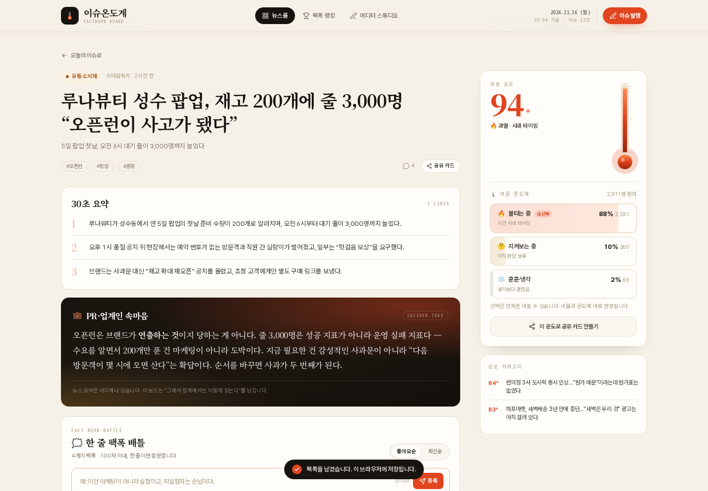
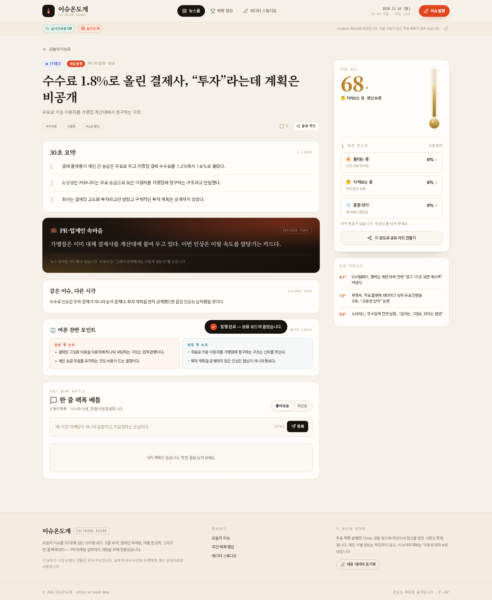
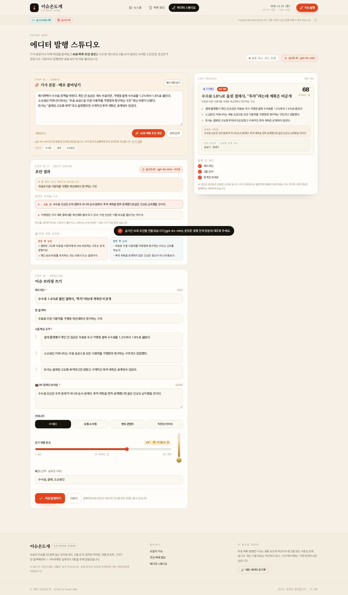
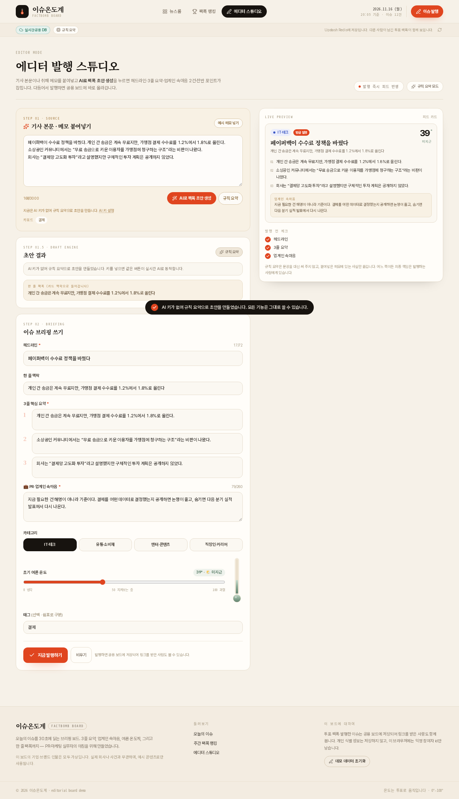
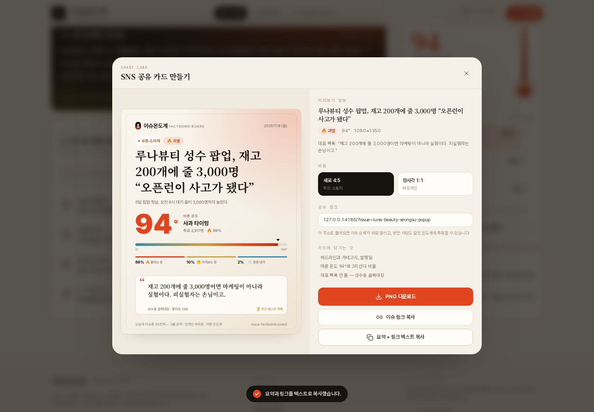
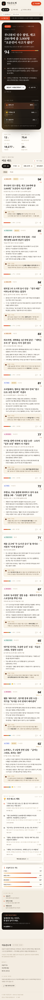
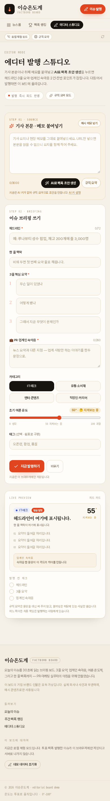

# 이슈온도계 — 한 줄 팩폭 이슈·트렌드 브리핑 보드 (실전형)

> **오늘의 이슈를 30초에 읽고, 한 줄로 참전하는 디지털 뉴스룸.**
> 기사 붙여넣기 → **AI 팩폭 초안** → 발행 → 여론 온도계 투표 → 한 줄 팩폭 → 공유 카드/링크까지, 한 화면에서.
> Vercel 서버리스 백엔드(`api/briefing`·`api/board`)로 **여러 사람이 같은 보드**를 보고, 키가 없으면 **로컬 체험 모드**로 그대로 동작합니다.


뉴스를 요약만 해 주는 서비스는 넘친다. 실무자가 알고 싶은 건 “그래서 업계에서는 이걸 어떻게 읽는가”다.
이슈온도계는 기사 요약 위에 **PR·업계인 속마음**을 얹고, 독자가 **0~100° 여론 온도계**에 투표하고 **한 줄 팩폭**으로 참전하며, 그 결과를 **공유 카드와 링크**로 들고 나갈 수 있게 만든 편집국형 보드다.

> 이 보드의 **데모** 기업·브랜드·인물·매체는 모두 가상입니다. 실제 회사나 사건과 무관하며, 예시 콘텐츠로만 사용됩니다.
> 코드·샘플·테스트에 실제 개인정보(실명·연락처·회사·키)는 들어 있지 않습니다.

---

## 1. 한눈에 보는 기능

| 영역 | 내용 |
| --- | --- |
| **뉴스룸 피드** | 오늘의 최고 온도 이슈 히어로 + 4개 카테고리 필터 + 온도순·최신순 정렬. 카드마다 온도 레일·3줄 요약·속마음 미리보기·투표 분포 |
| **이슈 브리핑** | 3줄 핵심 요약(30초), 💼 PR·업계인 속마음(+두 번째 시각), ⚖️ 여론 찬반 포인트, 태그, 출처·시각 |
| **여론 온도계** | 🔥 불타는 중 / 🤔 지켜보는 중 / ❄️ 훈훈·냉각 3지선다. 실시간 비율·참여 수·내 선택, 0~100° 온도계 |
| **팩폭 배틀** | 100자 한 줄 팩폭 등록(공용 보드에 저장), 좋아요 토글, 좋아요순·최신순, 내 글은 `나 · 익명 xxxx`로 구분 |
| **주간 베스트·랭킹** | 좋아요 순 리더보드 레일 + 랭킹 페이지(포디움·리스트·카테고리 필터) |
| **공유** | 1080×1350 / 1080×1080 PNG 카드, **`?issue=` 공유 링크**, 요약+링크 텍스트 복사 |
| **AI 에디터 스튜디오** | 기사 본문·메모 붙여넣기 → **AI로 팩폭 초안 생성**(한 줄 팩폭·3줄 요약·업계인 속마음 2건·찬반 포인트) → 다듬어 발행. AI가 없으면 **규칙 요약**으로 자동 폴백 |
| **연결 상태 배지** | 상단에 항상 `실시간 공용 DB` / `로컬 체험 모드`, `실시간 AI` / `규칙 요약`을 그대로 표시 |
| **무중단 쓰기** | 서버가 잠깐 죽어도 발행·투표·팩폭은 **이 기기에 보관**되고, 연결되면 자동으로 다시 올라갑니다(`동기화 대기 N`) |

---

## 2. 화면

### ① 뉴스룸 — “오늘 가장 뜨거운 것”부터


- 히어로는 **오늘의 최고 온도 이슈**. LIVE 배지, 카테고리, 출처·시각, 세로 온도계, 3지선다 투표를 한 판에 담았습니다.
- 히어로 아래 통계 스트립은 발행 수·평균 온도·누적 투표·팩폭 수를 실시간 집계합니다.
- 카드 왼쪽의 얇은 세로 레일이 그 이슈의 온도입니다. 색은 온도 밴드(과열~냉각)를 따릅니다.

### ② 이슈 상세 — 요약, 그리고 뉴스에 없는 한 문단



- **30초 요약**(3문장) → **💼 PR·업계인 속마음** → (AI 초안이 만든 경우) **같은 이슈, 다른 시각** · **⚖️ 여론 찬반 포인트** → **팩폭 배틀**.
- 사이드 패널은 스크롤을 따라오며 온도계·투표·공유·같은 카테고리 이슈를 붙잡아 둡니다.



- 위 화면은 `실시간 공용 DB` + `실시간 AI` 상태에서 AI 초안으로 발행한 이슈입니다. 속마음 2건 중 고른 문장이 본문에, 나머지가 “다른 시각”에 남고, 찬반 포인트가 함께 게시됩니다.

### ③ AI 에디터 스튜디오 — 붙여넣고, 초안 받고, 발행



- **AI로 팩폭 초안 생성** 한 번으로 헤드라인·한 줄 팩폭·3줄 요약·업계인 속마음 **2건**·여론 찬반 포인트가 잡힙니다.
- 두 속마음 중 하나를 골라 카드에 넣고, 나머지는 상세의 “다른 시각”으로 남깁니다. 찬반 포인트는 게시 여부를 직접 고릅니다.
- 키가 없거나 AI가 실패하면 **같은 버튼이 규칙 요약으로 내려갑니다**(사유를 화면에 표시).



### ④ 공유 카드 · 공유 링크

| 세로 4:5 (1080×1350) | 링크·텍스트 복사 |
| --- | --- |
|  | `?issue=<id>` 주소와 요약 텍스트를 한 번에 복사합니다. 받은 사람은 같은 상세 화면에서 바로 투표할 수 있습니다. |

- 실제 산출물: [`docs/share-card-sample.png`](docs/share-card-sample.png) (1080×1080)

### ⑤ 모바일 390px

| 모바일 피드 | 모바일 에디터 |
| --- | --- |
|  |  |

- 390px에서 가로 넘침 0, 콘솔 에러 0(자동 검증 항목). 상단 연결 상태 배지도 잘리지 않습니다.

---

## 3. 여론 온도는 어떻게 계산하나

온도는 **편집자의 시작 온도 + 독자 투표의 열기**를 섞은 값입니다. 작은 표 수에서 바늘이 요동치지 않도록 편집 온도에 8표 분량의 사전 가중치를 둡니다.

```
heat  = (100 × hot + 55 × watch + 12 × cool) / (hot + watch + cool)
temp  = round( (baseTemp × 8 + 100 × hot + 55 × watch + 12 × cool) / (8 + hot + watch + cool) )
        → 3 ~ 99°로 클램프
```

- 🔥 불타는 중 100°, 🤔 지켜보는 중 55°, ❄️ 훈훈·냉각 12°로 환산합니다.
- **데모 이슈 12건의 초기 투표수는 “에디터 기준값”** 으로 클라이언트에 있고, 서버·로컬 스냅샷에는 **실제 참여표만** 쌓입니다.
  화면에는 `기준값 + 실제표`를 보여 주므로, 로컬 모드와 공용 모드가 같은 숫자를 보여 줍니다.
- 밴드: 85° 이상 과열, 70° 이상 가열, 50° 이상 지켜보는 중, 30° 이상 미지근, 그 아래 냉각.

---

## 4. 구조

```
api/
├─ briefing.ts              # POST /api/briefing — OpenAI 팩폭 초안 (키 없으면 501 no_key)
└─ board.ts                 # GET·POST /api/board — 이슈·투표·팩폭 공용 저장 (Upstash/Supabase/임시)
src/
├─ App.tsx                  # 라우팅(?issue= 공유 링크 + #/issue/:id + #/ranking + #/editor), 상태 배지, 모달/토스트
├─ hooks/useBoard.ts        # 공용 보드 병합, 낙관적 쓰기, outbox 재전송, 25초 폴링
├─ lib/
│  ├─ api.ts                # /api/* 클라이언트(타임아웃·모드 판별·AI 결과 정규화·익명 id)
│  ├─ repo.ts               # 로컬 스냅샷(v2) — 시드·검증·마이그레이션
│  ├─ content.ts            # 카테고리·반응 정의, 가상 브랜드 시드 이슈 12건 + 팩폭 26건 + 기준 투표수
│  ├─ draft.ts              # 오프라인 규칙 요약 엔진(AI 폴백)
│  ├─ temp.ts               # 온도·밴드·비율(최대잔여법)
│  ├─ share-card.ts         # Canvas 공유 카드 렌더러
│  └─ selectors.ts / format.ts
└─ components/              # ConnectionStrip·ApiKeyModal·EditorStudio·IssueDetail·ShareModal·…
scripts/
├─ serve.mjs                # 실제 서버리스 함수를 그대로 띄우는 로컬 서버(+가짜 Upstash·가짜 OpenAI)
└─ verify.py                # 세 가지 배포 상황 E2E (정적 / 공용DB+AI / 공용DB+키없음)
vercel.json                 # Vite dist + api/*.ts, installCommand: npm ci --include=dev
```

### 저장이 어디로 가나

| 상황 | 배너 표시 | 저장 위치 |
| --- | --- | --- |
| `UPSTASH_REDIS_REST_URL/TOKEN` 설정 | **실시간 공용 DB** | Upstash Redis 한 개 키(`factbomb:board:v1`)에 JSON 문서 |
| `SUPABASE_URL` + `SUPABASE_SERVICE_ROLE_KEY`(또는 `ANON_KEY`) | **실시간 공용 DB** | Supabase 테이블 `factbomb_board`의 `id='main'` 행(jsonb) |
| 위 키 없음(Vercel에 API만 배포) | **로컬 체험 모드** | 함수 인스턴스 임시 메모리 + 클라이언트 localStorage |
| GitHub Pages(정적 빌드) | **로컬 체험 모드** | localStorage만 |

- 저장소가 응답하지 않아도 **500으로 죽지 않습니다.** 임시 저장소로 내려가고 배너가 그 사실을 알려 줍니다.
- localStorage 스냅샷 키는 `factbomb.board.v2` 입니다. v1(정적 데모) 데이터는 한 번 초기화됩니다.

---

## 5. API

### `POST /api/briefing` — AI 팩폭 초안

```jsonc
// 요청
{ "title": "기사 제목(선택)", "body": "기사 본문 또는 취재 메모", "angle": "짚고 싶은 관점(선택)", "category": "tech", "apiKey": "AQ.… (Gemini, 선택) 또는 sk-… (OpenAI, 선택)" }

// 200
{
  "ok": true, "engine": "ai", "provider": "gemini", "model": "gemini-3.8-flash", "latencyMs": 2310,
  "result": {
    "headline": "팩폭 헤드라인(40자 이내)",
    "oneLiner": "한 줄 팩폭",
    "kicker": "한 줄 맥락",
    "summary": ["무슨 일", "어떻게 됐나", "무엇이 문제인가"],
    "insider": ["업계인 속마음 1", "업계인 속마음 2"],
    "debate": { "pro": ["찬성 논리"], "con": ["반대 논리"] },
    "category": "tech", "baseTemp": 68, "tags": ["수수료", "결제"]
  }
}
```

- 키 순서: `GEMINI_API_KEY`(서버) → `OPENAI_API_KEY`(서버) → 요청 키(`x-api-key` 헤더 → 본문 `apiKey`).
  요청 키가 `sk-…`가 아니면(Google AI Studio 키 `AQ.…`, 구 형식 `AIza…`) Gemini로, `sk-…`면 OpenAI로 보냅니다.
- **Gemini(무료 티어)이 기본**입니다. 신규 발급 키는 `AQ.`로 시작하고, 2026년 11월 현재 신규 사용자에게는 `gemini-2.5-flash`가 404(`no longer available`)이므로 기본 모델은 **`gemini-3.8-flash`** 입니다(모델이 없으면 `gemini-3.6-flash`로 한 번 더 시도).
- 키가 없으면 `501 { "error": "no_key" }` → **앱은 요청조차 보내지 않고 규칙 요약으로 갑니다**(키 상태는 `GET /api/briefing`으로 미리 확인).
- 400(`memo_too_short`/`memo_too_long`), 429(`rate_limited`, IP당 1분 15회), 502/504(업스트림 오류·시간 초과)를 구분해 돌려줍니다.
- 보내는 값: `systemInstruction`에 에디터 프롬프트, `generationConfig: { responseMimeType: "application/json", temperature: 0.4 }`. 응답은 `candidates[].content.parts[]`의 `thought`가 아닌 텍스트만 이어 붙여 JSON으로 읽습니다.
- 모델은 `GEMINI_MODEL`·`OPENAI_MODEL`로, 엔드포인트는 `GEMINI_BASE_URL`·`OPENAI_BASE_URL`로 바꿀 수 있습니다(테스트용 가짜 서버도 이걸 씁니다).
- `GET /api/briefing`은 `{ ok, ai, provider: "gemini"|"openai"|null, model, serverKey, keys: { gemini, openai } }`만 돌려줍니다. 키 값은 내려보내지 않습니다.
- 프롬프트는 **메모에 없는 사실·수치·인물을 만들지 않도록** 제한하고, 실존 인물의 실명·연락처를 새로 쓰지 않게 지시합니다.

### `GET /api/board?voterId=…` — 보드 읽기

```jsonc
{ "ok": true, "mode": "shared", "store": "redis",
  "issues": [...], "votes": { "issue-x": { "hot": 3, "watch": 1, "cool": 0 } },
  "comments": [...], "myVotes": { "issue-x": "hot" }, "updatedAt": 1763…,
  "counts": { "issues": 13, "comments": 27, "votes": 4 } }
```

### `POST /api/board` — 발행·투표·팩폭

```jsonc
{ "action": "publish", "voterId": "v…", "issue": { "id": "issue-…", "headline": "…", "summary": ["…"], "insider": "…", "baseTemp": 60, "category": "tech", "tags": [] } }
{ "action": "vote",    "voterId": "v…", "issueId": "issue-…", "reaction": "hot" }
{ "action": "comment", "voterId": "v…", "comment": { "id": "c-…", "issueId": "issue-…", "text": "한 줄 팩폭" } }
```

- **모든 쓰기는 idempotent** 합니다. 이슈 id·팩폭 id는 클라이언트가 만들어 보내고 서버는 upsert 합니다. 그래서 네트워크가 끊겨 재전송해도 중복이 생기지 않습니다.
- 투표는 `voterId`별로 **한 표**만 유지되고, 바꾸면 이전 표가 빠집니다. 응답의 `votes`가 그 이슈의 최신 집계입니다.
- 팩폭 작성자는 서버가 `익명 <voterTag 4자>`로 정합니다. **IP·이메일·계정은 저장하지 않습니다.**
- 길이·형식 검증: 헤드라인 4~72자, 요약 3줄 각 180자, 속마음 400자, 팩폭 1~100자, 이슈 300건·팩폭 2,000건 상한.

---

## 6. 배포

### A. Vercel (실전형: 공용 보드 + 실시간 AI)

1. 리포지토리를 Vercel에 연결하면 `vercel.json` 설정대로 `npm ci --include=dev` → `npm run build` → `dist/` + `api/*.ts`가 올라갑니다. 프레임워크는 Vite, `maxDuration`은 briefing 60초 / board 30초.
2. Project → Settings → Environment Variables 에 아래를 넣고 **Redeploy** 합니다.

| 변수 | 필수 | 설명 |
| --- | --- | --- |
| `GEMINI_API_KEY` | 선택(권장) | Google AI Studio 무료 키(`AQ.…`). 있으면 Gemini가 우선입니다. 없으면 AI 없이 규칙 요약으로 동작합니다. |
| `GEMINI_MODEL` | 선택 | 기본 `gemini-3.8-flash` |
| `OPENAI_API_KEY` | 선택 | 기존 OpenAI 경로(`sk-…`). Gemini 키가 없을 때만 쓰입니다. |
| `OPENAI_MODEL` | 선택 | 기본 `gpt-4o-mini` |
| `UPSTASH_REDIS_REST_URL` | 선택(권장) | Upstash Redis REST URL |
| `UPSTASH_REDIS_REST_TOKEN` | 선택(권장) | Upstash Redis REST 토큰 |
| `SUPABASE_URL` | 선택 | Supabase 프로젝트 URL |
| `SUPABASE_SERVICE_ROLE_KEY` | 선택 | 서버 전용 키(권장). 없으면 `SUPABASE_ANON_KEY` 사용 |

3. **공용 DB 없이도 배포는 됩니다.** 이때 배너는 `로컬 체험 모드`로 표시되고, 투표·발행은 인스턴스 메모리와 각자 브라우저에 저장됩니다(재시작 시 초기화).

**Supabase를 쓸 때 필요한 테이블** (SQL Editor에서 1회):

```sql
create table if not exists public.factbomb_board (
  id text primary key,
  data jsonb not null default '{}'::jsonb,
  updated_at timestamptz not null default now()
);
alter table public.factbomb_board enable row level security;
-- 서버리스 함수는 service_role 키로 접근하므로 RLS 정책을 열지 않습니다(공개 노출 방지).
```

**Upstash를 쓸 때**: Redis 데이터베이스 생성 → REST URL·토큰 복사 → 위 두 변수에 붙여넣기. 저장은 키 하나(`factbomb:board:v1`)에 JSON 문서로 들어갑니다.

### B. GitHub Pages (정적 데모)

- `.github/workflows/deploy.yml`이 `npm run build`로 `dist/`를 올립니다. 이 빌드는 `GITHUB_ACTIONS`가 켜져 있어 **`/api/*` 탐색을 아예 하지 않는 정적 빌드**가 되고(콘솔 404 없음), 배너는 `로컬 체험 모드 · 규칙 요약`으로 뜹니다.
- 정적 호스팅임을 강제하려면 `VITE_STATIC_ONLY=1 npm run build`.

---

## 7. 실행과 검증

```bash
# Node 22+
npm install
npm run dev                  # http://localhost:5185 (Vite)
npm run build                # tsc(--noEmit) + tsc -p tsconfig.api.json + vite build
npm run typecheck            # 앱 + api 타입 검사

# 실제 서버리스 함수를 로컬에서 그대로 띄우기
npm run serve -- --port 4186 --api=on --store=redis --ai=on
#   --api=off        /api/* 404 (정적 호스팅 흉내)
#   --store=redis    가짜 Upstash REST로 공용 DB 경로 검증
#   --store=memory   공용 DB 없이 체험 모드
#   --ai=on          가짜 OpenAI로 실시간 AI 경로 검증(실제 키 불필요)
npm run dev                  # 다른 터미널: API_PROXY_TARGET=http://127.0.0.1:4186 npm run dev

# E2E (세 가지 배포 상황을 한 번에)
npm run verify               # = python3 scripts/verify.py
```

기술 스택: **Vite 7 · React 19 · TypeScript 5.9 · Tailwind CSS 4 · lucide-react**, 백엔드는 **Vercel Node 함수**(의존성 0, 표준 `fetch`만 사용). 폰트는 Pretendard(jsDelivr)·Noto Serif KR(Google Fonts), 없으면 시스템 폰트로 대체합니다.

### 검증 결과 (이번 개조 후)

| 항목 | 결과 |
| --- | --- |
| `npx tsc --noEmit` (앱) | **0 errors** |
| `tsc -p tsconfig.api.json` (api) | **0 errors** |
| `npm run build` | **성공** |
| Playwright E2E (`scripts/verify.py`) | **61/61 통과**, 콘솔 에러·경고 **0** (의도적으로 끊은 오프라인 실험 구간 제외) |
| 모바일 390×844 | 피드·상세·편집기 모두 가로 넘침 **없음**, 상태 배지 잘림 없음 |

검증한 시나리오:

- **A. 정적 호스팅 모드**: 배지 `로컬 체험 모드`·`규칙 요약`, `/api` 요청 0건, 시드 12건·온도 94°, 투표 저장(기준값과 분리), 팩폭 등록·`나 · 익명`, 공유 카드 PNG·`?issue=` 링크·텍스트 복사, 규칙 요약 초안 → 발행 → 리로드 유지, 공유 링크로 상세 열기, 모바일 390 넘침 0.
- **B. 공용 DB + AI**: 배지 `실시간 공용 DB`·`실시간 AI`, AI 초안(헤드라인·한 줄 팩폭·3줄·속마음 2건·찬반), 속마음 B 선택 반영, 발행 후 찬반 카드·다른 시각 게시, **다른 브라우저**에서 공유 링크로 열고 투표·팩폭 → 원래 브라우저 새로고침에 반영, 서버 장애(요청 강제 abort) 시 `동기화 대기 1` → 연결 복구 후 **자동 재전송**되어 다른 브라우저에서도 열림.
- **C. 공용 DB + 키 없음**: 배지 `실시간 공용 DB`·`규칙 요약`, AI 버튼이 규칙 요약으로 폴백, `/api/briefing`은 `501 no_key`, `/api/board`는 `mode: shared·store: redis`.

---

## 8. 초안 엔진 두 가지

**① 실시간 AI(`api/briefing.ts`)** — 서버 키 또는 개인 키가 있을 때. 붙여넣은 본문만 근거로, 없는 사실은 만들지 않도록 프롬프트에서 제한합니다. 결과는 형식 검증 후 정규화합니다.

**② 규칙 요약(`src/lib/draft.ts`)** — 키가 없거나 AI가 실패했을 때. 결정적이고 오프라인이며, 메모에 실제로 있는 것만 옮깁니다.
URL은 출처로만 남기고(CORS로 본문을 못 읽는 한계를 숨기지 않음), 첫 줄/첫 문장으로 헤드라인 후보를 만들고, 다음 문장으로 3줄 요약을 채우고 모자라면 “N줄만 채웠다”고 알립니다. 카테고리 키워드 사전과 트리거(품절·논란·철회 +9, 인상·개편 +6, 발표·출시 +3)로 초기 온도를 28~92°에서 추정하고, 한국어 조사(을/를·은/는)는 받침을 보고 붙입니다.

---

## 9. 개인정보와 안전

- 코드·시드·테스트에 **실명·연락처·실제 회사·실제 API 키가 없습니다**(데모 기업은 모두 가상).
- 공용 보드에 저장하는 것은 이슈·투표 집계·팩폭 텍스트·익명 참여자 id의 **해시 꼬리표**뿐입니다. IP는 요청 제한에만 쓰고 저장하지 않습니다.
- 개인 OpenAI 키를 화면에서 넣으면 **그 브라우저 localStorage**에만 저장되고, 초안 생성 요청 본문으로만 전송됩니다(URL·화면·로그에 남기지 않음). 서버 키가 있으면 개인 키는 쓰지 않습니다.
- 팩폭·이슈는 React 텍스트로만 렌더링합니다(HTML 주입 없음). 길이·형식은 서버에서도 검증합니다.
- 공개 배포 시 `/api/briefing`은 인스턴스당 IP 1분 15회로 제한합니다(비용 보호). 대규모 공개 전에는 Upstash 기반 제한으로 바꾸는 것을 권합니다.

---

## 10. 알려진 한계와 다음 단계

- **URL 본문 수집 없음** — 서버리스 함수가 기사 URL을 직접 읽어 오지 않습니다(저작권·차단 이슈). 본문을 붙여넣는 방식입니다.
- **좋아요는 기기 기준** — 팩폭 좋아요는 이 브라우저에만 반영됩니다(랭킹은 기기별). 공용 집계가 필요하면 `/api/board`에 `like` 액션을 추가하면 됩니다.
- **동시 쓰기** — Redis/Supabase 모두 읽고-고치고-쓰기 방식이라 같은 순간의 두 쓰기는 마지막 것이 이깁니다. 소규모 보드에는 충분하지만, 트래픽이 커지면 샤딩된 카운터나 트랜잭션으로 바꿔야 합니다.
- **모더레이션 없음** — 신고·숨김·작성자 인증은 아직 없습니다. 공개 운영 전에 필요합니다.
- **온도는 편집 가중치가 들어간 값** — 순수 투표 비율이 아닙니다. 계산식을 공개해 두었으니 `PRIOR`와 가중치를 정책에 맞게 조정하면 됩니다.
- **데모 시드 12건** — 실제 운영에서는 시드를 비우고(`src/lib/content.ts`) 발행된 이슈만 쓰는 편이 자연스럽습니다.

---

© 2026 이슈온도계 · 모든 데모 기업·브랜드·인물은 가상입니다.
